[Playlists](xref:Learn-Library-Playlists) are lists of media items that can be created for playback. 


## Creating a Playlist

Any media item can added to a playlist, an existing one or a new one to be created. Click on the **...** context menu button on any media entity on the Emby server and you have the option to add to a playlist.

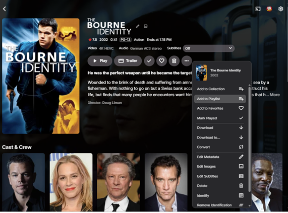

Once you click on "**Add to Playlist**", you are given the option to select an existing playlist or create a new playlist.

It is not limited to a specific movie or a music track, in fact, you can select any entity in the libraries and add that to a playlist. e.g. Adding music for a specific artist.

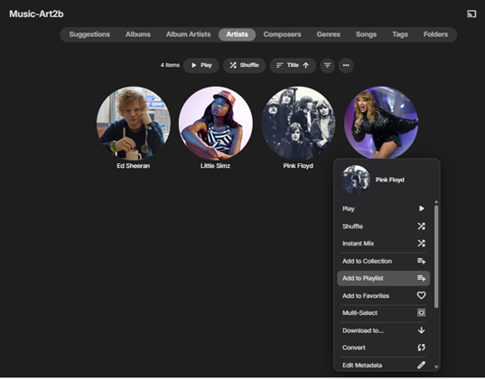

Clicking **Add to Playlist** gives you a dialogue box like this:

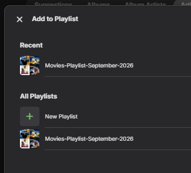

This shows a view of the Music playlist created for two artists: Ed Sheeran and Pink Floyd.

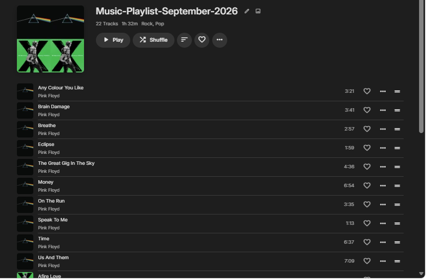

The Playlists view now shows the two playlists created in the examples above.

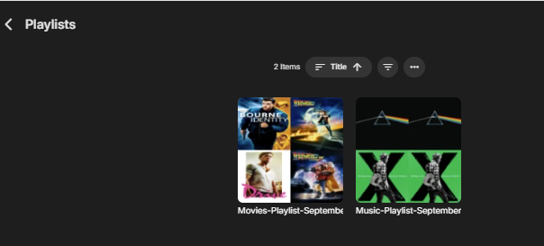


## Playlist playback options

Items in a playlist can be played shuffled, or as ordered in the playlist. Options are also available for sorting the playback in different ways. The playlist can also be added to Favorites.

This is an example of a playlist of 3 movies created by selecting individual movies and then using the "**Add to Playlist**" menu option. The playlist was added to **Favorites**.

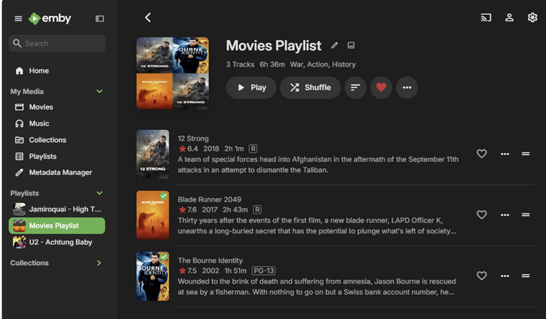

 
## Playlist sort options

This shows the various sort options that are available.

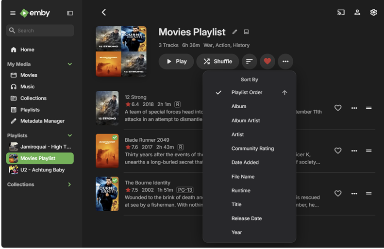


## Playlist Actions Menu

The "**...**" context menu button is available for playlists and lists the various actions that can be performed.

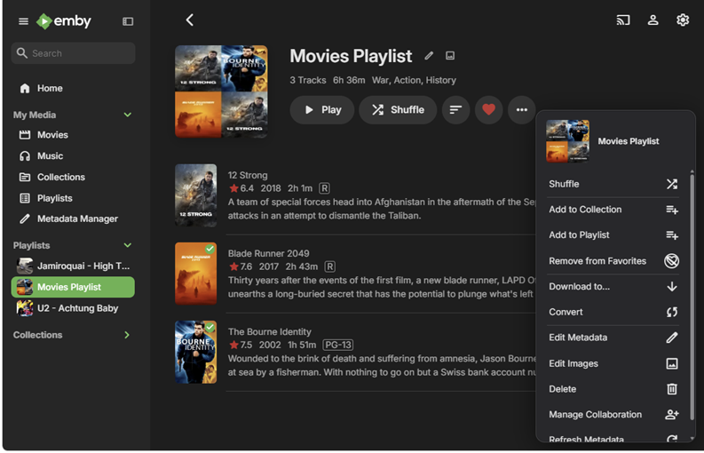


## Removing an item from a playlist

Media items can be removed from a playlist by clicking on the "**...**" menu button for the item when viewing the playlist, and then selecting the **Remove from Playlist** action.

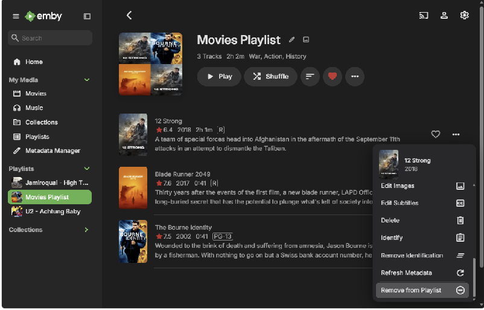


## Deleting a Playlist

To delete a playlist, click on the "**...**" menu button for the playlist and select **Delete**.

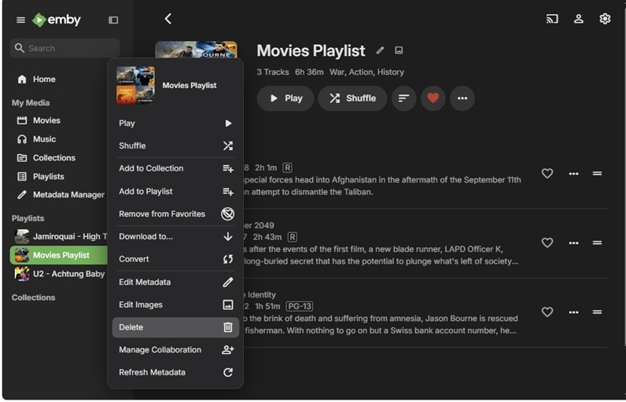


## Importing Playlists

Playlists can be imported into Emby Server by placing the playlist files within the media folders, e.g. a music album playlist file added to the music library folder. This can be an .m3u or .m3u8 file, with the difference being the file encoding, the system default for the .m3u file or UTF-8 encoding for the .m3u8 file. See  [M3U Playlists](xref:Learn-Media-M3U-Playlists).

The playlist files, as minimum, contain duration, title and path to the media files. For portability avoid using absolute paths and instead have paths relative to the folder where the playlist file is. See the [Relative paths resolve from the playlist folder](xref:Learn-Media-M3U-Playlists) section in the **M3U Playlists** article.

> [!Important]
> Make sure that the paths and filenames in the m3u/m3u8 file are correct.
>

> [!Tip]
> It is advisable to save a copy of any playlist file that you wish to import.
>

## Single Music Album Playlists with custom playlist posters

The following is an example of adding an m3u8 playlist file for a music album and having a custom poster for the playlist.

**Playlist: Jamiroquai - High Times - The Singles 1992 to 2006.m3u8**

Extract showing the m3u8 file contents for the first 4 tracks
```
#EXTM3U
#EXTINF:229,When You Ganna Learn
01-When You Ganna Learn.mp3
#EXTINF:203,Too Young to Die
02-Too Young To Die.mp3
#EXTINF:236,Blow Your Mind
03-Blow Your Mind.mp3
#EXTINF:217,Emergency on Planet Earth
04-Emergency On Planet Earth.mp3
```
and this shows the directory structure and the playlist file and the playlist image with the same name for the poster:

```
├───Jamiroquai
│   └───High Times - The Singles 1992 to 2006
│           01-When You Ganna Learn.mp3
│           02-Too Young To Die.mp3
│           03-Blow Your Mind.mp3
│           04-Emergency On Planet Earth.mp3
│           05-Space Cowboy.mp3
│           06-Virtual Insanity.mp3
│           07-Cosmic Girl.mp3
│           08-Alright.mp3
│           09-Deeper Underground.mp3
│           10-Canned Heat.mp3
│           11-Little L.mp3
│           12-Love Foolosophy.mp3
│           13-Corner Of The Earth.mp3
│           14-Feels Like It Should.mp3
│           15-7 Days In Sunny June.mp3
│           16-(Don't) Give Hate A Chance.mp3
│           17-Runaway.mp3
│           18-Radio.mp3
│           Jamiroquai - High Times - The Singles 1992 to 2006.jpg
│           Jamiroquai - High Times - The Singles 1992 to 2006.m3u8
``` 
The Music library **Albums** view shows the default poster for this album.

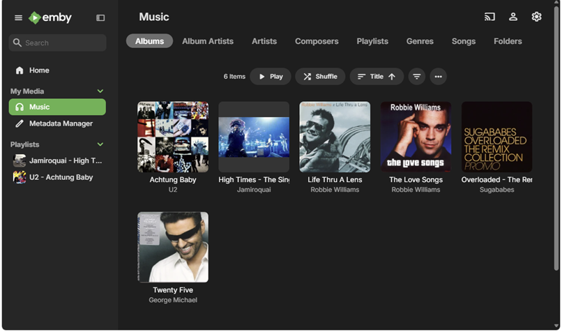

The Playlist has a custom poster which shows in the **Playlists** tab.

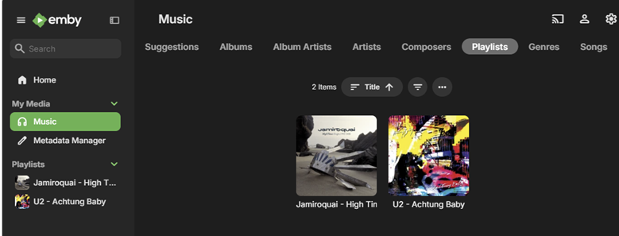


