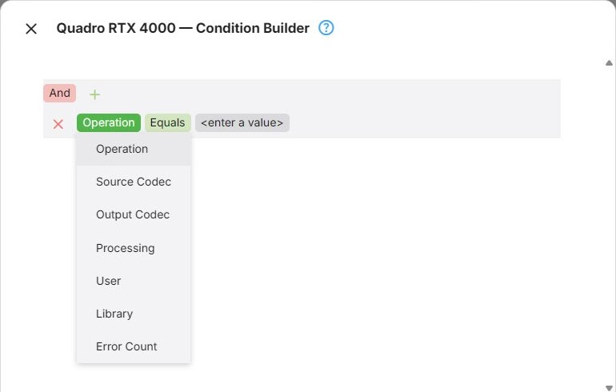
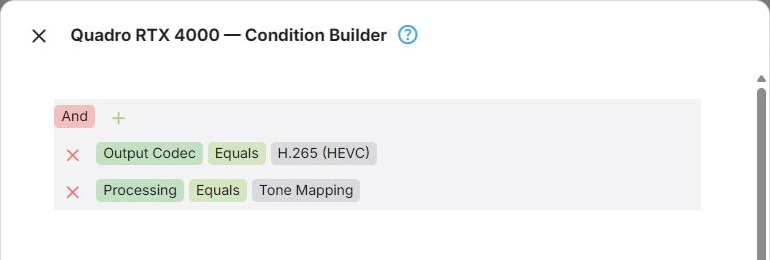
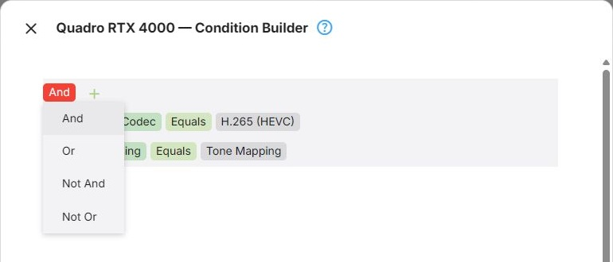

Every node in the graph can carry conditions, which decide whether that node applies to the operation being
evaluated. A node whose conditions do not match is passed over, and evaluation carries on as if it were not
there.

Expert Mode shows a filter builder here, in place of the short list of operation kinds that
[Advanced Mode](Advanced-Mode.md#conditions) offers. The filter builder can combine several fields, with
and/or groups, rather than only saying which kinds of operation a node applies to.

Conditions apply to containers as well as to device nodes. A condition on a Condition Group applies to
everything inside it - which is the entire purpose of that container, see
[Node Types](Expert-Node-Types.md#condition-group). Nodes inside the container can carry their own
conditions on top.

## Available Fields

| Field | What it matches |
|---|---|
| Operation | The kind of operation: Conversions, LiveTV, Playback, HlsPlayback, LiveStream |
| Source Codec | The video codec of the source |
| Output Codec | The video codec being produced - AV1, H.264 or HEVC |
| Processing | A processing step the operation involves: Closed Captions, [Tone Mapping](xref:Learn-Tone-Mapping-HDR-to-SDR), [Subtitle Burn-In](xref:Learn-Subtitle-Burn-In), Subtitle Overlay |
| User | The user the playback or conversion belongs to |
| Library | The library the item comes from |
| Error Count | How many failed attempts precede this node being used - see below |

An operation can involve more than one processing step at once - tone mapping and subtitle burn-in
together, for instance.



## Building a Condition

The **Conditions** command on a node opens the Condition Builder. A condition compares one field with a
value - for example *Output Codec Equals AV1*. Conditions are collected in groups, and groups can be nested
inside each other, so there is no limit to how many conditions a node can have or how they are combined.

The builder starts out with a single, empty group.

### Adding and Removing Conditions

1. Click **+** next to a group and choose **Add Condition**.
2. Click the field name of the new condition and pick the field to match on - see
   [Available Fields](#available-fields).
3. Click the operation and pick how the field is compared - see [Operations](#operations).
4. Click the value and enter what the field is compared with. Fields with a fixed set of values - the
   operation kinds, codecs, processing steps, users and libraries - offer them in a list.

To remove a condition, or a group with everything in it, click the **×** button in front of it.



### Operations

Which operations the builder offers depends on the type of the field:

| Field | Operations |
|---|---|
| Operation, Source Codec, Output Codec, Processing, User, Library | Equals, Does not equal, Is any of, Is none of |
| Error Count | Equals, Does not equal, Is greater than, Is greater than or equal to, Is less than, Is less than or equal to, Is between |

**Is any of** and **Is none of** take several values at once: *Output Codec Is any of H.264, HEVC* means the
same as two Equals conditions in an Or group. **Is between** takes two values and includes both of them.

### Groups

A group combines its conditions with one logical operator, shown at the top of the group. Click it to
choose another:

| Operator | The group matches when |
|---|---|
| And | all of its conditions match |
| Or | at least one of its conditions matches |
| Not And | not all of its conditions match |
| Not Or | none of its conditions match |



Conditions are combined with **and** or **or**, but not both within one group. To express a mixture, nest
a group inside another with **+** and **Add Group**: the inner group counts as a single condition of the
outer one, and its own operator is independent of the outer one's.

For example, to have a node handle AV1 output for one library, and anything a particular user plays:

```
Or
├── And
│   ├── Output Codec   Equals   AV1
│   └── Library        Equals   Movies
└── User   Equals   Alice
```

Written out, that is *(Output Codec Equals AV1 And Library Equals Movies) Or User Equals Alice*.

Save the dialog to update the node in the graph, then save the configuration to make the conditions take
effect - see [Saving](Transcoding-Configuration.md#saving).

## Conditions on Fallback and Failure Points

Conditions on nodes that take part in fallback calculation are evaluated in the second pass just as they
are in the first - see [Fallback Paths](Expert-Fallback-Paths.md#fallback-paths-in-expert-mode).

What makes the two passes distinguishable from inside a condition is **Error Count**: the number of failed
attempts that precede this node being used.

- During the first pass nothing has failed yet, so it is **0**
- During the second pass it starts at **1** and increases by one for each fallback point already found and
  added to the list - so the first fallback is evaluated with 1, the second with 2, the third with 3

That gives you a way to state when a node applies at all:

| Condition | Effect |
|---|---|
| `Error Count = 0` | Effectively disables the node for fallback use - the equivalent of not marking it as a fallback point |
| `Error Count > 0` | Applies only as a fallback, never during initial selection |
| `Error Count = 1` | Applies only as a fallback when no previous fallback attempt has been made |

The most common use is on a Failure Point. By default a Failure Point applies in both passes, which stops
evaluation outright. Giving it `Error Count > 0` leaves the first attempt alone while stopping any further
ones - "try this, but do not keep trying if it fails" - see
[Failure Point](Expert-Node-Types.md#failure-point).

The same applies to a device node marked as a fallback point: a condition on Error Count decides whether
that node is used as a fallback at all, and whether only as the first one.
