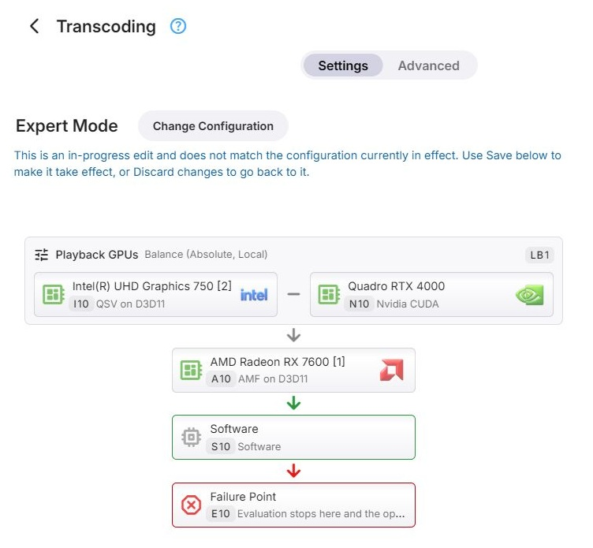

# Graph Evaluation

## Two Passes of Evaluation

> [!WARNING]
> This is crucial knowledge for understanding Expert mode Configurations

- PASS 1: GPU/SW Config Selection
- PASS 2: Fallback Paths Calculation

This practically means that the first pass determines which GPU should be used and with which configuration (or SW
transcoding with a certain configuration).

The 2nd pass though, is about deciding what should happen in case when the configuration chosen by the first pass
would result in an error.

## Evaluation Order

Graph evaluation happens in the same order like when reading a book:

- Row after row from top to bottom
- Within each row from left to right

That order is also indicated by the arrows in the graph.

## Exceptions

- Different rules apply inside a Load Balancing container - see [Load Balancing](Expert-Load-Balancing.md)
- For fallback calculation, only fallback point nodes are considered  
  => These are nodes which have a green or red border and are preceded by a green or red arrow

How the second pass uses this is described in [Fallback Paths](Expert-Fallback-Paths.md).



## When the Graph Is Evaluated

The graph is evaluated once for each transcoding operation, before FFmpeg is started - when a playback
starts transcoding, and for each conversion. Both passes run at that time, so the fallbacks are known before
the first attempt is made.

The same evaluation applies in all three modes. Basic Mode and Advanced Mode build the graph for you: the
devices in order, with the software node last as the fallback point.

Nothing is evaluated when there is no video to transcode - for audio-only operations, and when the video is
copied unchanged. Image extraction does not use the graph either; it has its own
[settings](../Settings.md#image-extraction).

## What Takes Part

Before evaluation starts, everything that cannot be used is taken out of the graph:

- nodes that are switched off, including everything inside a group that is switched off
- device nodes whose device is not present - including the devices of a remote host that is switched off
- groups that are left without nodes

The FFmpeg log shows both the graph as configured and the graph that was actually evaluated - see
[Reading the Result in the Log](#reading-the-result-in-the-log).

## How a Node Is Judged

In the first pass, nodes are looked at in [evaluation order](#evaluation-order), and the first one that
applies to the operation is selected. Whether a node applies is decided as follows.

### Conditions

A node whose [conditions](Expert-Conditions.md) do not match is passed over - for a group, together with
everything inside it. Live TV is never transcoded on a remote device.

### Device Nodes

A device node - GPU Config or Software Config - applies when its device can perform the operation the way
the node is configured:

- **Load** - only for a node directly inside a load balancing group: the node is passed over when it, or
  its device across the whole graph, has reached its [limit](Expert-Load-Balancing.md#limits).
- **Subtitles** - when the operation burns in subtitles and the node is set to *Skip this configuration*
  for that kind of subtitles, the node is passed over - see [Subtitle Burn-In](Subtitle-Burn-In.md).
- **Encoder** - the node needs an encoder for the output codec, and that encoder has to accept the output:
  its resolution, bitrate, profile and level. An encoder selection of *Skip* passes the node over.
  Hardware encoders also require an active Emby Premiere subscription.
- **Decoder** - the node's decoder for the source codec has to be able to read the source: its resolution,
  bitrate, color format, profile, level and bit depth.
  - A decoder selection of *Skip* passes the node over.
  - When the selected hardware decoder cannot read the source, **When a selected hardware decoder is not
    suitable** decides: *Use software decoding* keeps the node, decoding in software and still encoding on
    the device; *Skip this configuration* passes the node over.
  - For source codecs the device cannot decode at all - the ones offered no decoder selection -
    **Allow software decoding for other codecs** decides whether the node is used with software decoding or
    passed over.

Filters - deinterlacing, scaling, tone mapping - do not decide whether a node applies. When the selected
node offers no suitable filter for a processing step, a software filter is used for that step where there
is one.

### Condition Groups

A condition group is entered when its conditions match, and its nodes are judged in order, from left to
right. When none of them applies, evaluation continues after the group. A group is never selected itself, and
load limits play no part inside a condition group.

### Load Balancing Groups

When its conditions match, a load balancing group selects one of its nodes according to its
distribution - the first one below its limits for overflow, the one with the least load for balance; see
[Load Balancing](Expert-Load-Balancing.md). When none of its nodes applies, evaluation continues after the
group.

### Failure Points

A failure point whose conditions match stops evaluation. When no node has been selected before it, the
operation fails.

### When Nothing Applies

When evaluation reaches the end of the graph without having selected a node, the operation fails. The log
says *No entry of the configuration applies to this operation*.

## When an Attempt Fails

The selected node is tried first. When FFmpeg fails to start - it exits with an error, or the expected
output does not appear, for a playback within 15 seconds - the next node from the list of fallbacks is
tried, up to three of them. The log notes each change:
*Previous transcoding attempt failed. Falling back to configuration 'S1'.*

The list is not calculated again for a retry. A transcode that has started successfully and fails later does
not move on to a fallback, nor does one that was stopped. Live TV only uses the selected node.

## Example: Try Another Context Before Software

Suppose you want to try **Vulkan (Nvidia)** for HEVC output, retry on the same GPU with **Nvidia CUDA** if
that attempt fails to start, and use software as the last resort. The GPU must offer both contexts and a
suitable HEVC encoder in each. This example assumes playback already requires HEVC output; a condition on
the output codec does not change the codec that Emby has chosen.

In Expert Mode, arrange three nodes in this order, outside any container:

```
N1  Same GPU, Vulkan (Nvidia)
 |
N2  Same GPU, Nvidia CUDA     [Fallback point]
 |
S1  Software                 [Fallback point]
```

The IDs are examples; use the IDs assigned to your own nodes when reading the log.

1. Configure the first GPU node to use **Vulkan (Nvidia)**. Set its condition to
   **Output Codec Equals HEVC**, and leave **Fallback point** off.
2. Add a second node for the same GPU and configure it to use **Nvidia CUDA**. Leave its conditions empty
   and turn **Fallback point** on. It can then be selected either initially or as a fallback.
3. Place the Software node last, leave its conditions empty and turn **Fallback point** on.
4. Save the dialogs, then [save the configuration](Transcoding-Configuration.md#saving).

For an HEVC playback operation that all three nodes can handle, the first pass selects N1. The second pass
adds N2 and S1 to the fallback list, in that order. Both passes finish before FFmpeg starts. If the Vulkan
attempt fails to start, Emby retries with Nvidia CUDA; if that also fails to start, it tries software.

The following is an **illustrative, abbreviated log**, with the GPU name shown as a placeholder and the
detailed capability checks omitted:

```
Transcoding configuration (Expert)
Configured: N1 🠊⬩ N2 🠊⬩ S1
Effective:  N1 🠊⬩ N2 🠊⬩ S1
N1 => Match

Selected: N1 <GPU name> - Vulkan (Nvidia)

Fallback configuration (Expert)
N2 => Match
S1 => Match
```

If the first attempt subsequently fails to start, the log records:

```
Previous transcoding attempt failed. Falling back to configuration 'N2'.
```

If the operation instead requires H.264 output, N1 reports `UnmetNodeConditions`. N2 can then be selected
in the first pass, with S1 as its fallback. Likewise, if N1 matches the condition but fails a capability
check, evaluation continues to N2 immediately, without starting an FFmpeg attempt on N1.

## Reading the Result in the Log

The FFmpeg log of every transcode - see [FFmpeg Logs](../operations/Logs.md#ffmpeg-logs) - records the
evaluation, between the information about the media and the FFmpeg command line. For example:

```
Transcoding configuration (Advanced)
Configured: N1 🠊 I1 🠊⬩ S1
Effective:  N1 🠊⬩ S1
N1 => DecoderBitDepthNotSupported
    …

S1 => Match
    …

Selected: S1 Software - Software

Fallback configuration (Advanced)
```

- **Configured** is the graph as saved, **Effective** the graph that was evaluated, after taking out what
  cannot be used - here I1, which is switched off.
- `🠊` leads to the node that is tried next, `━━` joins the nodes of a load balancing group, braces
  enclose the nodes of a group - for example `CG1{N2 🠊 S2}` - and `⬩` marks a fallback point or a failure
  point.
- Each node that was judged gets a line with its [ID](Graph-Editing.md#reading-the-graph) and the result,
  followed by the details of the checks.
- **Selected** names the node, its device and its context type. The section after it lists the fallback
  candidates in the same way.

| Result | Meaning |
|---|---|
| `Match` | The node applies |
| `UnmetNodeConditions` | The node's conditions do not match |
| `GpuLoadAtLocalMaximum`, `GpuLoadAtGlobalMaximum` | The node, or its device across the graph, is at its limit |
| `OtherGpuHasLessLoad` | In a balancing group, another node has less load |
| `SubtitlesSkipped` | The node is set to skip this kind of subtitle burn-in |
| `NoEncoder`, `NoDecoder` | No encoder for the output codec, or no decoder for the source codec |
| `EncoderHardwareNotAllowed` | Hardware encoding requires Emby Premiere |
| `Encoder…`, `Decoder…` | The encoder or decoder cannot handle the operation - the name says which limit, for example `EncoderMaxWidthExceeded` or `DecoderBitDepthNotSupported` |
