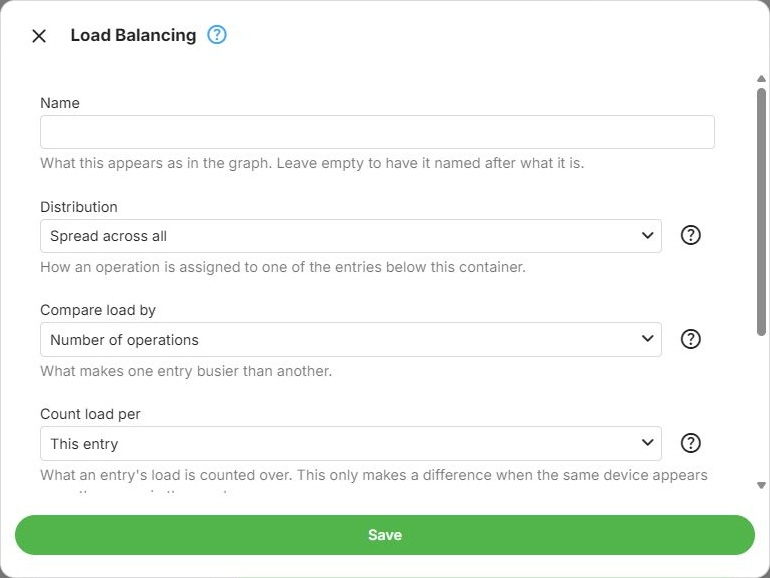
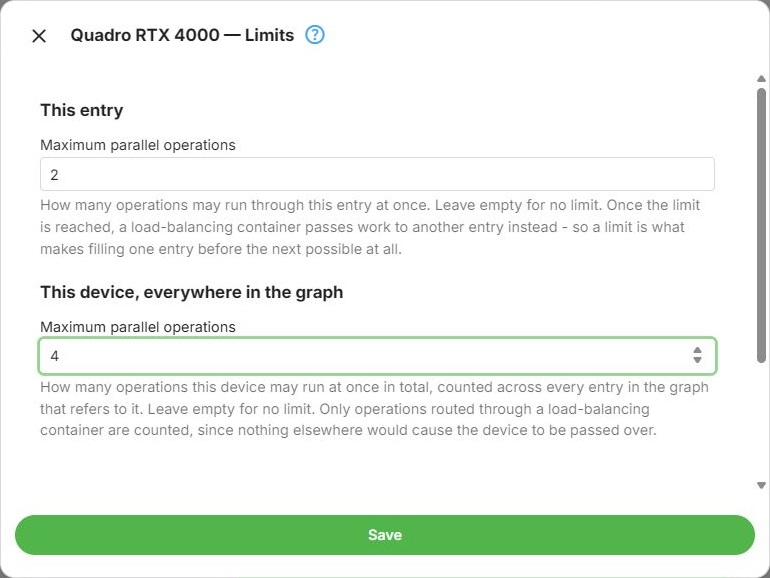

A Load Balancing Group distributes transcoding work across the nodes it contains, rather than trying them
in order until one applies. It is inserted like any other container - see
[Node Types](Expert-Node-Types.md).

The container itself decides how work is assigned to the nodes below it. The nodes decide how much work
they will accept.

## Distribution

**Overflow** uses the nodes in order, each until its own limit is reached, then the next one. The graph
draws these as an ordered, left-to-right row, because the order is what determines which node is used
first.

**Balance** uses whichever eligible node is currently least loaded. The graph draws these as an unordered
row because load determines the selection. When two nodes have equal load, the first in the configured
order is selected.

In the dialog, **Fill one, then the next** selects Overflow, and **Spread across all** selects Balance.



> [!IMPORTANT]
> Overflow only does something if the nodes have limits. Without a limit a node never becomes full, so
> nothing ever overflows to the next one - see [Limits](#limits).

## Comparing Load

These two only apply to **Balance**, since Overflow never compares one node against another.

**Compare load by** decides what makes one node busier than another:

- **Absolute** (**Number of operations** in the dialog) compares the raw number of operations
- **Relative** (**Proportion of its limit**) compares each node's share of its own limit, so a node with a
  smaller limit is not simply favoured for having a smaller number of operations on it

**Count load per** decides what a node's load is counted over:

- **Local** (**This entry** in the dialog) counts the operations running through that node
- **Global** (**The device behind it**) counts the operations running through the device behind it,
  across the whole graph

For example, suppose N1 has one running operation and N2 has three, both on the same GPU. N1's load is
**1** with **This entry**, or **4** with **The device behind it**. The device total includes N2 even if N2
is outside a load-balancing group.

For **Relative** comparisons, **This entry** uses the node's own limit, while **The device behind it**
uses the device limit. If that limit is empty, the raw operation count is used instead of a proportion.
For example, a node with one operation and no limit has a comparison value of 1, while a node with five
operations and a limit of ten has a value of 0.5. Set a positive limit for every candidate in the selected
scope when you want all candidates compared as proportions.

## Limits

Each node inside a load-balancing container has its own **Limits**, reachable from the node's own command
menu. Two limits are edited together there, because neither reads sensibly on its own:

**This node** - how many operations may run through this particular node at once. Leave it empty for no
limit. Once the limit is reached, the container passes work to another node instead, which is what makes
Overflow possible at all.

**This device, everywhere in the graph** - a limit checked against all operations running on the device,
counted across every node in the graph that refers to it. When that total reaches the limit, this node is
passed over. Leave it empty for no limit.

Both limits are checked when selecting a node inside a load-balancing group, regardless of **Count load
per**. That choice only determines how Balance compares the load of eligible nodes. Operations elsewhere
in the graph contribute to the device total, but nodes outside load-balancing groups are not passed over
because of these limits.



## Evaluation Inside a Load Balancing Group

Inside an **Overflow** group, nodes are considered from left to right, and the first eligible node below
both limits is selected. Inside a **Balance** group, eligible nodes are compared by load, with configured
order used only to break ties. This is one of the exceptions noted in
[Graph Evaluation](Expert-Graph-Evaluation.md#exceptions).

## Fallback Points in a Load Balancing Group

Only one node of a load balancing group can be a [fallback point](Expert-Fallback-Paths.md), and it has to
be the last one. A configuration that breaks this rule cannot be saved - the message names the node to
move or to clear.

## Example: Overflow from One GPU to Another

Suppose the first GPU should handle up to two simultaneous operations, the second up to three, and
additional operations should use software. In Expert Mode:

1. Insert a Load Balancing Group and choose **Fill one, then the next** (Overflow).
2. Put the first GPU node on the left and the second on the right. Use two different GPUs, each appearing
   only once in this example, and leave their conditions empty.
3. Open **Limits** on the first GPU node. Set both **This node** and **This device, everywhere in the
   graph** to **2**. Set both limits on the second GPU node to **3**.
4. Place a Software node after the group, with **Fallback point** on. Leave the GPU nodes' fallback
   switches off, then save the configuration.

```
Overflow group:  GPU A (limit 2) -> GPU B (limit 3)
                                      |
                                 Software
```

Assume both GPUs can handle every operation in this example. Starting with no jobs running, start each
new job after the previous one is running, and keep the earlier jobs active: jobs 1 and 2 select GPU A;
jobs 3, 4 and 5 select GPU B; job 6 passes over both full GPU nodes and selects Software. Once a job on GPU A
finishes, the next new job can select GPU A again. Existing jobs stay where they are running.

In this example, a full GPU node reports `GpuLoadAtLocalMaximum` in the evaluation log. This is selection
based on current load, before an attempt starts. If a selected GPU attempt fails to start, this example
falls back to Software; Overflow alone does not make the other GPU a retry candidate.

## Further Reading

<xref:Learn-Hardware-Encoder-Sessions>
