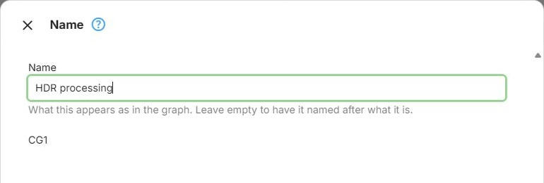
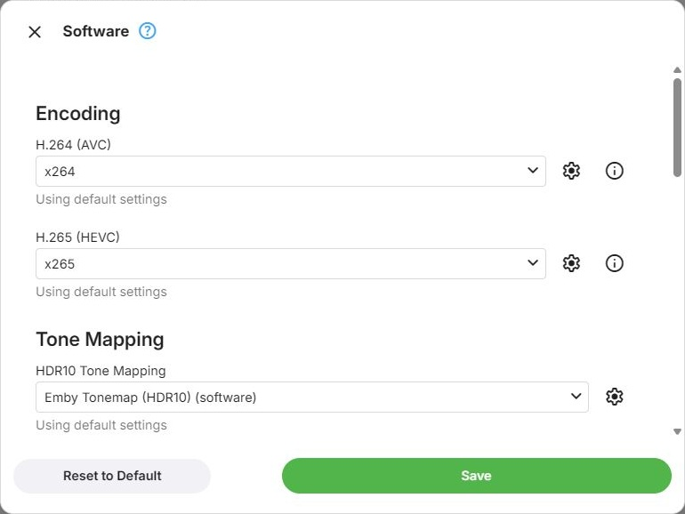
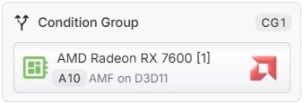

# Node Types

## Names and IDs

Every node has an **Id**, such as `N10`, which is assigned when the node is created and kept for as long as
it exists. Evaluation reports nodes by this ID, so a line in a log can be followed back to the node it is
about.

Nodes can also be given a **Name**, which the graph shows instead of what the node is. For nodes other than
GPU and software nodes, the **Configure** command opens a dialog with just the name and the ID; a
load-balancing group has its name at the top of its [load balancing](Expert-Load-Balancing.md) dialog.
Leaving the name empty names the node after what it is again.

## GPU Config

A GPU Config node is one device used in one particular way. It names a detected device and holds
everything about how that device is to be used: which [hardware context](xref:Learn-Hardware-Frame-Surfaces), which encoders and decoders, which
filters, and any settings those have of their own.

In Expert Mode the same device may appear more than once, each time as a separate node with its own
configuration - which is what makes it possible to try a card one way first and a different way as a
fallback. Each node carries the short name the graph shows it under, a letter for the vendor and a number,
such as `N10` for an Nvidia device.

Opening a node's configuration gives you:

**Hardware Context** - which context type to use, where the device offers more than one. An Nvidia card
typically offers [Nvidia CUDA](xref:Learn-Hardware-NVIDIA-CUDA) and [Vulkan (Nvidia)](xref:Learn-Hardware-Vulkan); an Intel card on Linux can offer
[QSV on VAAPI](xref:Learn-Hardware-Intel-QSV), [VAAPI (Intel)](xref:Learn-Hardware-Linux-VAAPI) and Vulkan (Intel). The choice matters:
contexts differ in performance, in which filters they support, and in maturity. Where a device offers only
one, this is not shown. See [Hardware Acceleration](../hardware/Overview.md) for what each vendor offers.

**Encoding** - which encoder to use for H.264, HEVC and AV1 output. Each has its own parameters, reachable
from the button beside it, and an info button describing what the encoder reports about itself - see
[Encoders](encoders/Encoders.md).

**Tone Mapping** - which [tone mapping](xref:Learn-Tone-Mapping-HDR-to-SDR) filter to use for each kind of HDR, each with its own
parameters - see [Filters](filters/Filters.md).

**Subtitles** - how text subtitles and graphic subtitles are burned into the video when that is necessary -
see [Subtitle Burn-In](Subtitle-Burn-In.md).

**Decoding** - which decoder to use per source codec: H.264, HEVC, AV1, MPEG-2, H.263, MPEG-4, VC-1, VP8
and VP9. Every one of these lists the software decoder for that codec alongside the hardware ones, so
decoding in software while encoding on the GPU is a normal thing to configure.

**Options** - vendor-specific behaviour, where the context has any. Currently only the Nvidia CUDA context
does; see [Nvidia](../hardware/vendors/Nvidia.md).

**Fallback point** - makes this node eligible for a retry after an earlier selected configuration fails.
A marked node can still be selected for the first attempt. The switch is only offered in Expert Mode.
Inside a load-balancing group, only one node may be marked as a fallback point, and it must be the last
node in that group. This placement restriction does not apply at the top level or inside a condition
group. See [Fallback Paths](Expert-Fallback-Paths.md).

Every encoder and decoder dropdown also carries a **Skip** option. Selecting it opts this node out of
handling that media type entirely, which is how you express "use this card, but not for AV1".

Anything you do not change stays on the device's automatic choice rather than being frozen at whatever was
current when you configured it - see [Delta Storage](Transcoding-Configuration.md#delta-storage).

## Software Config

A Software Config node is transcoding on the CPU, represented as a node so that it can take part in the
graph like any other node. In a default configuration it is the last node, marked as the fallback point -
which is what Emby's built-in software fallback amounts to. In Expert Mode neither of those is fixed.

It is configured the same way a GPU node is, but there is no Hardware Context to choose, software being the
only one. Encoding, Decoding, Tone Mapping and Subtitles offer software codecs, tone mapping filters and
the CPU choices for subtitle burn-in.

**Software Specific Options** includes **Video Resolution Limit**, which scales larger video down before
CPU tone mapping to reduce the processing load. The default is no limit.

Its decoding section differs from a GPU node's in one respect worth knowing: it offers every software
decoder present, rather than a subset chosen for compatibility with the encoder. Software encoders and
decoders are always mutually compatible, so there is nothing to narrow down.

Expert Mode allows more than one software node, which is what lets you configure software transcoding
differently in different circumstances - one configuration for ordinary playback, another as a last resort
after several hardware attempts have failed. In Basic and Advanced Mode there is exactly one, it sits at the
end of the graph, and it cannot be moved or unmarked as the fallback point.

## Condition Group

A condition group is merely a container which allows to apply the same conditions to a group of nodes.
That group of nodes will be shown inside the container with a left-to-right order for visual clarity.
Functionally, a Condition Group doesn't provide any extra value and is equivalent to having the same
nodes in top-down order with the same set of conditions applied.
In this regard, a Condition Group is rather a kind of visual/syntactical sugar for better clarity and
simplified configuration, especially when considering that nodes inside a Condition Group can have their
own conditions atop.

## Load Balancing Group

With a Load Balancing Group, you can distribute transcoding load across multiple GPUs.

Details for setting up Load Balancing are described in [Load Balancing](Expert-Load-Balancing.md).

## Failure Point

You can insert a Failure Point wherever you want to stop any further transcoding attempts to be made.
By default, a Failure Point hits in both passes (see [Graph Evaluation](Expert-Graph-Evaluation.md)).
If you want a Failure Point to be effective only in fallback cases (PASS 2), you can set a condition
on it for Error Count > 0.
