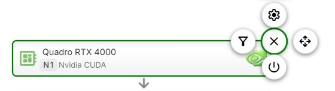
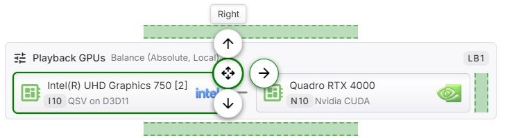
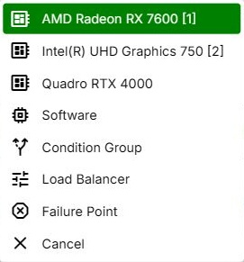

Each item in the configuration graph is a **node**. In Advanced Mode and Expert Mode, every node has its own
menu - the fly-out - through which it is configured, switched on and off, moved, and in Expert Mode inserted
and removed. Basic Mode has no fly-out: there the graph only shows the result of the **Hardware acceleration**
selection - see [Basic Mode](Basic-Mode.md).

## Opening the Menu

Click or tap a node, or press Enter or Space while it has the focus. The menu opens at the node's top
right corner, as round icon buttons arranged around a **Close** button in the middle. Hovering over a
button, or moving the focus to it, shows its name above the menu.

Escape, **Close**, a click on empty space or another click on the node closes the menu again.

A double-click on a node opens its configuration directly - **Configure**, or **Balancing** for a load
balancing group.

## Commands

The menu only shows the commands that apply to the node. Each command keeps its position, so it is always
found in the same place:

| Position | Command |
|---|---|
| Above the middle | **Configure** or **Balancing**, and above that **Limits** |
| Left | **Conditions**, and further left **Remove** |
| Right | **Move** |
| Below the middle | **Disable** or **Enable**, and below that **Insert** |

**Configure** opens the settings of the node. For a device node, these are the device's encoders,
decoders, filters, subtitles and options - see [Device Configuration](Advanced-Mode.md#device-configuration)
and [GPU Config](Expert-Node-Types.md#gpu-config). For a condition group, it is the group's name. The
command is not offered for a device that is not present on this system, nor in Advanced Mode for a device
that is switched off.

**Balancing** takes the place of Configure on a load balancing group and opens its distribution settings
and its name - see [Load Balancing](Expert-Load-Balancing.md).

**Conditions** decides which operations the node applies to. Advanced Mode offers a list of operation
kinds - see [Conditions](Advanced-Mode.md#conditions). Expert Mode offers the condition builder - see
[Node Conditions](Expert-Conditions.md). Not offered on the software node in Advanced Mode.

**Disable** and **Enable** switch the node off and on. A switched-off node stays in the graph with its
configuration, but takes no part in [evaluation](Expert-Graph-Evaluation.md) - for a group, that includes
everything inside it. In Advanced Mode a switched-off device moves below the divider, and its menu only
offers **Enable** - see [Switching Devices Off](Advanced-Mode.md#switching-devices-off). The software node
in Advanced Mode cannot be switched off.

**Move** lets the node be moved to another position - see [Moving a Node](#moving-a-node).

**Limits** is offered in Expert Mode on a device node directly inside a load balancing group. It sets the
maximum number of operations running in parallel, for this node and for the device everywhere in the graph -
see [Limits](Expert-Load-Balancing.md#limits).

**Insert** adds a new node, in Expert Mode - see [Inserting a Node](#inserting-a-node).

**Remove** deletes the node, in Expert Mode, after a confirmation. Removing a group removes everything
inside it.

Whether a device node is a fallback point is not a command of the menu but a setting at the end of its
configuration dialog, under **Evaluation** - see [Fallback Paths](Expert-Fallback-Paths.md).

## Moving a Node

After **Move**, the menu shrinks to the directions in which the node can go - **Top**, **Bottom**,
**Left** and **Right** - and the graph marks each possible position with a dashed band. Click a band, or
press the arrow key for that direction, to move the node one step. Moving stays active after each step, so
the node can be moved step by step until it is where you want it. Click **Move** again, press Escape, or
click elsewhere to stop.

In Advanced Mode, only devices that are switched on and present can be moved, and only among each other -
the software node always stays at the end.

In Expert Mode, moving a node towards a group moves it into that group, and a node inside a group can be
moved out of it again. Groups cannot be placed inside other groups.

## Inserting a Node

**Insert** opens a list of what can be added at that position:

- every device that is present, with the software option last. Remote devices start with the ID of their
  [remote host](../operations/OmniTranscode.md), for example *R1:*. The same device can be added more than
  once - with a different configuration each time, for example. Devices of a remote host that is switched
  off are not offered.
- **Condition Group**, **Load Balancer** and **Failure Point** - groups only at the top level of the graph.
  Inside a group, only devices and failure points can be added.

The new node is inserted after the node the menu was opened on, or at the end of the group when the menu
was opened on a group. Moving starts right away, so the node can be put into place.

## Reading the Graph

- **IDs** - every node carries a short ID that identifies it, made up of a letter for its kind and a
  number: *N* Nvidia, *I* Intel, *A* AMD, *V* Apple, *R* Rockchip, *M* Android, *S* software, *CG* condition
  group, *LB* load balancing group, *E* failure point. Nodes of remote devices start with the host's ID,
  for example *R1:N 2*. The [FFmpeg log](Expert-Graph-Evaluation.md#reading-the-result-in-the-log) refers to
  nodes by the same IDs. IDs are not shown in Basic Mode.
- **Arrows** - a downward arrow leads to the node that is tried next. Inside a condition group, and inside
  a load balancing group that distributes by overflow, the arrows point to the right. A load balancing group
  that balances the load joins its nodes with plain lines instead, since none of them comes first.
- **Green** borders and arrows mark fallback points, **red** ones failure points - see
  [Visual Indication of Fallback and Failure Points](Expert-Fallback-Paths.md#visual-indication-of-fallback-and-failure-points).
- **Faded** nodes are switched off. Inside a group that is switched off, nodes are faded as well and
  offer no commands.
- **Unavailable**, with a dashed border, marks a device that is not present on this system. **Host
  disabled** marks a device of a remote host that is switched off.
- **Conditions** of a node are summarized at its bottom, next to a filter icon.

## Saving

Changes take effect only when the configuration is saved - see [Saving](Transcoding-Configuration.md#saving).
