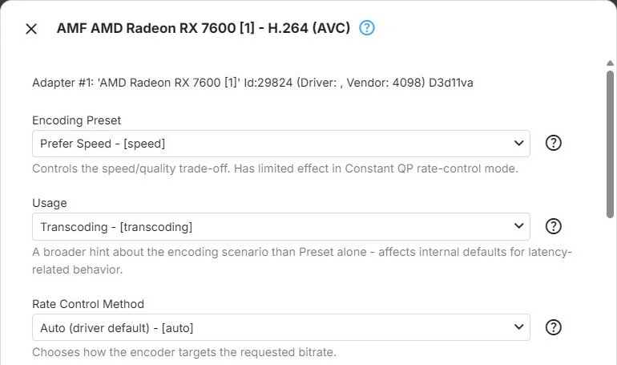

AMD GPUs encode through the [Advanced Media Framework (AMF)](xref:Learn-Hardware-AMD-AMF). These
parameters apply to the AMF encoders of the AMF on D3D11 and AMF on Vulkan context types - see
[AMD](../../hardware/vendors/AMD.md) for the context types, and [Encoders](Encoders.md) for how the dialog
works. The VAAPI (AMD) context type uses the [VAAPI](VAAPI.md) encoders, and Vulkan (AMD) the
[Vulkan](Vulkan.md) encoders.

## H.264

The `h264_amf` encoder for [H.264](xref:Learn-Video-Codec-H264), offered by the AMF on D3D11 and AMF on
Vulkan context types.

**Encoding Preset** - trades encoding speed against quality ([preset](xref:Learn-Video-Encoder-Presets),
ffmpeg `preset`). It has little effect with the **Constant QP** rate control method. Default: **Prefer
Speed**.

- **Prefer Speed** - prioritizes encoding speed, for real-time transcoding where keeping up with playback
  matters most
- **Balanced** - a middle ground between speed and quality, suitable for most general-purpose transcoding
- **Prefer Quality** - prioritizes quality, better suited to offline conversions than to live playback

**Usage** - tells the encoder which scenario it is working in, which sets its internal defaults for
latency-related behaviour (ffmpeg `usage`). A broader hint than the preset. Default: **Transcoding**.

- **Transcoding** - general-purpose transcoding. The recommended choice unless one of the more specific
  scenarios applies
- **High Quality** - tuned for the best achievable quality, without the latency constraints of the
  low-latency choices
- **Low Latency** - reduced encoding latency, less aggressively than Ultra Low Latency, for interactive or
  near-real-time streaming
- **Low Latency, High Quality** - aims for low latency and high quality at the same time - a narrower,
  more demanding scenario than either alone
- **Ultra Low Latency** - the lowest possible encoding latency, at a cost in compression efficiency
- **Webcam** - tuned for live camera capture such as video conferencing, rather than for transcoding
  existing media

**Rate Control Method** - how the encoder reaches the bitrate Emby requests (ffmpeg `rc`). With the two
constrained **Variable Bitrate** methods, only the target bitrate is passed to the encoder; with the other
choices, the requested bitrate is also passed as the maximum rate, with a buffer of twice the bitrate.
Default: **Auto (driver default)**.

- **Auto (driver default)** - sets no method, so the encoder chooses based on **Usage** and **Encoding
  Preset**. The recommended starting point
- **Constant QP** - encodes every frame with the same fixed
  [quantization parameter](xref:Learn-Video-Encoding-QP), using the encoder's default QP values:
  predictable per-frame quality, unpredictable size. **Enable VBAQ** has no effect in this mode
- **Constant Bitrate (CBR)** - holds the bitrate as close to constant as possible, regardless of scene
  complexity ([CBR](xref:Learn-Video-Encoding-CBR)). Useful for strict bandwidth limits, at the cost of
  quality consistency across scenes
- **Variable Bitrate, Peak-Constrained** - targets an average bitrate that varies with scene complexity,
  with a hard peak limit ([VBR](xref:Learn-Video-Encoding-VBR)). A common general-purpose choice for
  streaming
- **Variable Bitrate, Latency-Constrained** - like Peak-Constrained, but additionally constrained to limit
  encoding latency
- **Quality-Based Variable Bitrate** - targets a perceptual quality level instead of a bitrate, and lets
  the bitrate follow it within the overall limits ([constant quality](xref:Learn-Video-Encoding-Constant-Quality))
- **High-Quality Variable Bitrate** - a higher-quality variant of variable bitrate, at a higher processing
  cost
- **High-Quality Constant Bitrate** - a higher-quality variant of constant bitrate, at a higher processing
  cost

**Enable VBAQ** - adaptive quantization: redistributes bits from complex areas of the picture to flat,
low-detail areas, where blocking is most visible (ffmpeg `vbaq`). It has no effect with the **Constant
QP** rate control method. Default: off.

**Low Latency Mode** - requests low-latency behaviour inside the encoder (ffmpeg `latency`). Independent of
the low-latency **Usage** choices, and can be combined with any of them. Default: off.

**Encoding Profile Limit** - the highest H.264 profile the encoder may use; empty (the default) means no
limit - see [Encoding Profile Limit](Encoders.md#encoding-profile-limit). Offers those of
**Constrained Baseline Profile**, **Main Profile** and **High Profile** that the driver reports.

## HEVC

The `hevc_amf` encoder for [HEVC](xref:Learn-Video-Codec-HEVC), offered by the AMF on D3D11 and AMF on
Vulkan context types.

**Encoding Preset** - trades encoding speed against quality (ffmpeg `preset`). It has little effect with
the **Constant QP** rate control method. Default: **Prefer Speed**.

- **Prefer Speed** - prioritizes encoding speed, for real-time transcoding where keeping up with playback
  matters most
- **Balanced** - a middle ground between speed and quality, suitable for most general-purpose transcoding
- **Prefer Quality** - prioritizes quality, better suited to offline conversions than to live playback

**Usage** - tells the encoder which scenario it is working in, which sets its internal defaults for
latency-related behaviour (ffmpeg `usage`). A broader hint than the preset. Default: **Transcoding**.

- **Transcoding** - general-purpose transcoding. The recommended choice unless one of the more specific
  scenarios applies
- **High Quality** - tuned for the best achievable quality, without the latency constraints of the
  low-latency choices
- **Low Latency** - reduced encoding latency, less aggressively than Ultra Low Latency, for interactive or
  near-real-time streaming
- **Low Latency, High Quality** - aims for low latency and high quality at the same time - a narrower,
  more demanding scenario than either alone
- **Ultra Low Latency** - the lowest possible encoding latency, at a cost in compression efficiency
- **Webcam** - tuned for live camera capture such as video conferencing, rather than for transcoding
  existing media

**Tier** - the HEVC [tier](xref:Learn-Video-Codec-Levels-Tiers), which sets the maximum bitrate allowed at
the encoding level in use (ffmpeg `profile_tier`). Default: **Main**.

- **Main** - the standard tier, sufficient for the vast majority of content and bitrates
- **High** - allows a higher maximum bitrate at a given level. Only relevant for unusually high bitrates;
  most playback devices support the Main tier only

**Rate Control Method** - how the encoder reaches the bitrate Emby requests (ffmpeg `rc`). With the two
constrained **Variable Bitrate** methods, only the target bitrate is passed to the encoder; with the other
choices, the requested bitrate is also passed as the maximum rate, with a buffer of twice the bitrate.
Default: **Auto (driver default)**.

- **Auto (driver default)** - sets no method, so the encoder chooses based on **Usage** and **Encoding
  Preset**. The recommended starting point
- **Constant QP** - encodes every frame with the same fixed quantization parameter, using the encoder's
  default QP values: predictable per-frame quality, unpredictable size. **Enable VBAQ** has no effect in
  this mode
- **Constant Bitrate (CBR)** - holds the bitrate as close to constant as possible, regardless of scene
  complexity. Useful for strict bandwidth limits, at the cost of quality consistency across scenes
- **Variable Bitrate, Peak-Constrained** - targets an average bitrate that varies with scene complexity,
  with a hard peak limit. A common general-purpose choice for streaming
- **Variable Bitrate, Latency-Constrained** - like Peak-Constrained, but additionally constrained to limit
  encoding latency
- **Quality-Based Variable Bitrate** - targets a perceptual quality level instead of a bitrate, and lets
  the bitrate follow it within the overall limits
- **High-Quality Variable Bitrate** - a higher-quality variant of variable bitrate, at a higher processing
  cost
- **High-Quality Constant Bitrate** - a higher-quality variant of constant bitrate, at a higher processing
  cost

**Enable VBAQ** - adaptive quantization: redistributes bits from complex areas of the picture to flat,
low-detail areas, where blocking is most visible (ffmpeg `vbaq`). It has no effect with the **Constant
QP** rate control method. Default: off.

**Low Latency Mode** - requests low-latency behaviour inside the encoder (ffmpeg `latency`). Independent of
the low-latency **Usage** choices, and can be combined with any of them. Default: off.

**Encoding Profile Limit** - the highest HEVC profile the encoder may use; empty (the default) means no
limit - see [Encoding Profile Limit](Encoders.md#encoding-profile-limit). Offers those of
**Main Profile** and **Main 10 Profile** that the driver reports. The encoder's bit depth follows the
output, 8 or 10 bit.

## AV1

The `av1_amf` encoder for [AV1](xref:Learn-Video-Codec-AV1), offered by the AMF on D3D11 and AMF on
Vulkan context types.
AV1 encoding is used for media conversions only, not for transcoding during playback.

**Encoding Preset** - trades encoding speed against quality (ffmpeg `preset`). It has little effect with
the **Constant QP** rate control method. Default: **Prefer Speed**.

- **Prefer Speed** - prioritizes encoding speed, for real-time transcoding where keeping up with playback
  matters most
- **Balanced** - a middle ground between speed and quality, suitable for most general-purpose transcoding
- **Prefer Quality** - prioritizes quality, better suited to offline conversions than to live playback
- **Highest Quality** - the highest-quality preset, above Prefer Quality, at the highest processing cost

**Usage** - tells the encoder which scenario it is working in, which sets its internal defaults for
latency-related behaviour (ffmpeg `usage`). A broader hint than the preset. Default: **Transcoding**.

- **Transcoding** - general-purpose transcoding. The recommended choice unless one of the more specific
  scenarios applies
- **High Quality** - tuned for the best achievable quality, without the latency constraints of the
  low-latency choices
- **Low Latency** - reduced encoding latency, less aggressively than Ultra Low Latency, for interactive or
  near-real-time streaming
- **Low Latency, High Quality** - aims for low latency and high quality at the same time - a narrower,
  more demanding scenario than either alone
- **Ultra Low Latency** - the lowest possible encoding latency, at a cost in compression efficiency
- **Webcam** - tuned for live camera capture such as video conferencing, rather than for transcoding
  existing media

**Rate Control Method** - how the encoder reaches the bitrate Emby requests (ffmpeg `rc`). With the two
constrained **Variable Bitrate** methods, only the target bitrate is passed to the encoder; with the other
choices, the requested bitrate is also passed as the maximum rate, with a buffer of twice the bitrate.
Default: **Auto (driver default)**.

- **Auto (driver default)** - sets no method, so the encoder chooses based on **Usage** and **Encoding
  Preset**. The recommended starting point
- **Constant QP** - encodes every frame with the same fixed quantization parameter, using the encoder's
  default QP values: predictable per-frame quality, unpredictable size
- **Constant Bitrate (CBR)** - holds the bitrate as close to constant as possible, regardless of scene
  complexity. Useful for strict bandwidth limits, at the cost of quality consistency across scenes
- **Variable Bitrate, Peak-Constrained** - targets an average bitrate that varies with scene complexity,
  with a hard peak limit. A common general-purpose choice for streaming
- **Variable Bitrate, Latency-Constrained** - like Peak-Constrained, but additionally constrained to limit
  encoding latency
- **Quality-Based Variable Bitrate** - targets a perceptual quality level instead of a bitrate, and lets
  the bitrate follow it within the overall limits
- **High-Quality Variable Bitrate** - a higher-quality variant of variable bitrate, at a higher processing
  cost
- **High-Quality Constant Bitrate** - a higher-quality variant of constant bitrate, at a higher processing
  cost

The encoder's bit depth follows the output, 8 or 10 bit. AV1 encoders have no **Encoding Profile Limit**.

## Further Reading

<xref:Learn-Hardware-AMD-VCN>  
<xref:Learn-Index-video-encoding-quality-rate-control>
