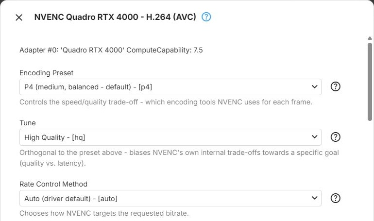
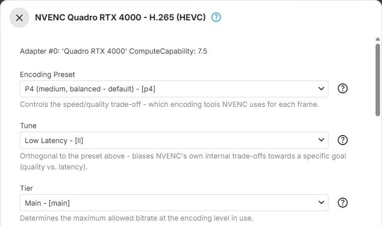

Nvidia GPUs encode with [NVENC](xref:Learn-Hardware-NVIDIA-NVENC), the dedicated encoding engine on the
card. These parameters apply to the NVENC encoders of the Nvidia CUDA context type - see
[Nvidia](../../hardware/vendors/Nvidia.md) for the context types, and [Encoders](Encoders.md) for how the
dialog works. The Vulkan (Nvidia) context type uses the [Vulkan](Vulkan.md) encoders instead.

## H.264

The `h264_nvenc` encoder for [H.264](xref:Learn-Video-Codec-H264), offered by the Nvidia CUDA context
type.

**Encoding Preset** - trades encoding speed against compression efficiency by choosing which encoding
tools NVENC uses for each frame ([preset](xref:Learn-Video-Encoder-Presets), ffmpeg `preset`). Each preset
is slower and more efficient than the one before it. Slower presets use more GPU time per frame, which also
reduces how many transcodes the GPU can run at the same time. Default: **P4 (medium, balanced - default)**.

- **P1 (fastest, lowest quality)** - the fewest encoding tools. For low-latency use where speed matters
  more than compression efficiency
- **P2 (faster, lower quality)**
- **P3 (fast, low quality)**
- **P4 (medium, balanced - default)** - NVENC's own default and a balanced middle ground, suitable for most
  real-time transcoding
- **P5 (slow, good quality)** - usually still fast enough for real-time use on current GPUs
- **P6 (slower, better quality)**
- **P7 (slowest, best quality)** - the most encoding tools and the most GPU time per frame

**Tune** - biases NVENC's internal trade-offs towards quality or latency, independently of the preset
(ffmpeg `tune`). Default: **High Quality**.

- **High Quality** - the best quality achievable at the chosen preset and bitrate. The recommended choice
  for on-demand transcoding
- **Low Latency** - reduces encoding latency at some cost in quality and efficiency, for interactive or
  near-real-time streaming
- **Ultra Low Latency** - reduces latency further, with lower quality and efficiency than Low Latency
- **Lossless** - mathematically lossless output instead of a bitrate and quality trade-off. Produces very
  large streams; not suited to streaming

**Rate Control Method** - how NVENC reaches the bitrate Emby requests (ffmpeg `rc`). With **Variable
Bitrate (VBR)**, only the target bitrate is passed to the encoder; with the other choices, the requested
bitrate is also passed as the maximum rate, with a buffer of twice the bitrate. Default: **Auto (driver
default)**.

- **Auto (driver default)** - sets no mode, so NVENC chooses based on the preset and tune. The recommended
  starting point
- **Constant QP** - encodes every frame with the same fixed
  [quantization parameter](xref:Learn-Video-Encoding-QP): predictable per-frame quality, unpredictable size.
  Rarely the right choice for streaming
- **Variable Bitrate (VBR)** - targets an average bitrate and lets it vary with scene complexity, for
  consistent quality ([VBR](xref:Learn-Video-Encoding-VBR)). Suits most transcoding
- **Constant Bitrate (CBR)** - holds the bitrate as close to constant as possible, regardless of scene
  complexity ([CBR](xref:Learn-Video-Encoding-CBR)). Useful for strict bandwidth limits, at the cost of
  quality consistency across scenes

**Multipass** - runs an extra analysis pass per frame inside NVENC, to place bits more accurately (ffmpeg
`multipass`). Unlike classic [two-pass encoding](xref:Learn-Video-Encoding-Two-Pass), the output is still
produced in a single run. Default: **Disabled (single pass)**.

- **Disabled (single pass)** - the fastest option
- **Two-Pass (quarter-resolution analysis)** - a fast analysis at quarter resolution before each frame is
  encoded. Better bit allocation than a single pass, at a modest speed cost
- **Two-Pass (full-resolution analysis)** - the analysis at full resolution. The most accurate bit
  allocation NVENC offers, at a higher speed and memory cost

**Spatial Adaptive Quantization** - redistributes bits within each frame from complex areas to flat,
low-detail areas such as skies and gradients, where blocking is most visible (ffmpeg `spatial-aq`).
Default: off.

**Temporal Adaptive Quantization** - redistributes bits across frames, based on how much each region
changes over time (ffmpeg `temporal-aq`). It complements spatial adaptive quantization, and both can be on
at the same time. Default: off.

**Adaptive Quantization Strength** - how aggressively spatial adaptive quantization redistributes bits,
from 1 (gentle) to 15 (aggressive) (ffmpeg `aq-strength`). Empty (the default) uses **8**. Shown only when
**Spatial Adaptive Quantization** or **Temporal Adaptive Quantization** is on, but has no effect when only
temporal adaptive quantization is enabled.

**Encoding Profile Limit** - the highest H.264 profile the encoder may use; empty (the default) means no
limit - see [Encoding Profile Limit](Encoders.md#encoding-profile-limit). Offers those of
**Baseline Profile**, **Main Profile**, **High Profile** and **High 4:4:4 Predictive Profile** that the GPU
reports.

## HEVC

*Example with Low Latency tuning selected.*

The `hevc_nvenc` encoder for [HEVC](xref:Learn-Video-Codec-HEVC), offered by the Nvidia CUDA context
type.

**Encoding Preset** - trades encoding speed against compression efficiency by choosing which encoding
tools NVENC uses for each frame (ffmpeg `preset`). Each preset is slower and more efficient than the one
before it. Slower presets use more GPU time per frame, which also reduces how many transcodes the GPU can
run at the same time. Default: **P4 (medium, balanced - default)**.

- **P1 (fastest, lowest quality)** - the fewest encoding tools. For low-latency use where speed matters
  more than compression efficiency
- **P2 (faster, lower quality)**
- **P3 (fast, low quality)**
- **P4 (medium, balanced - default)** - NVENC's own default and a balanced middle ground, suitable for most
  real-time transcoding
- **P5 (slow, good quality)** - usually still fast enough for real-time use on current GPUs
- **P6 (slower, better quality)**
- **P7 (slowest, best quality)** - the most encoding tools and the most GPU time per frame

**Tune** - biases NVENC's internal trade-offs towards quality or latency, independently of the preset
(ffmpeg `tune`). Default: **High Quality**.

- **High Quality** - the best quality achievable at the chosen preset and bitrate. The recommended choice
  for on-demand transcoding
- **Low Latency** - reduces encoding latency at some cost in quality and efficiency, for interactive or
  near-real-time streaming
- **Ultra Low Latency** - reduces latency further, with lower quality and efficiency than Low Latency
- **Lossless** - mathematically lossless output instead of a bitrate and quality trade-off. Produces very
  large streams; not suited to streaming

**Tier** - the HEVC [tier](xref:Learn-Video-Codec-Levels-Tiers), which sets the maximum bitrate allowed at
the encoding level in use (ffmpeg `tier`). Default: **Main**.

- **Main** - the standard tier, sufficient for the vast majority of content and bitrates
- **High** - allows a higher maximum bitrate at a given level. Only relevant for unusually high bitrates;
  most playback devices support the Main tier only

**Rate Control Method** - how NVENC reaches the bitrate Emby requests (ffmpeg `rc`). With **Variable
Bitrate (VBR)**, only the target bitrate is passed to the encoder; with the other choices, the requested
bitrate is also passed as the maximum rate, with a buffer of twice the bitrate. Default: **Auto (driver
default)**.

- **Auto (driver default)** - sets no mode, so NVENC chooses based on the preset and tune. The recommended
  starting point
- **Constant QP** - encodes every frame with the same fixed quantization parameter: predictable per-frame
  quality, unpredictable size. Rarely the right choice for streaming
- **Variable Bitrate (VBR)** - targets an average bitrate and lets it vary with scene complexity, for
  consistent quality. Suits most transcoding
- **Constant Bitrate (CBR)** - holds the bitrate as close to constant as possible, regardless of scene
  complexity. Useful for strict bandwidth limits, at the cost of quality consistency across scenes

**Multipass** - runs an extra analysis pass per frame inside NVENC, to place bits more accurately (ffmpeg
`multipass`). Unlike classic two-pass encoding, the output is still produced in a single run. Default:
**Disabled (single pass)**.

- **Disabled (single pass)** - the fastest option
- **Two-Pass (quarter-resolution analysis)** - a fast analysis at quarter resolution before each frame is
  encoded. Better bit allocation than a single pass, at a modest speed cost
- **Two-Pass (full-resolution analysis)** - the analysis at full resolution. The most accurate bit
  allocation NVENC offers, at a higher speed and memory cost

**Spatial Adaptive Quantization** - redistributes bits within each frame from complex areas to flat,
low-detail areas such as skies and gradients, where blocking is most visible (ffmpeg `spatial-aq`).
Default: off.

**Temporal Adaptive Quantization** - redistributes bits across frames, based on how much each region
changes over time (ffmpeg `temporal-aq`). It complements spatial adaptive quantization, and both can be on
at the same time. Default: off.

**Adaptive Quantization Strength** - how aggressively spatial adaptive quantization redistributes bits,
from 1 (gentle) to 15 (aggressive) (ffmpeg `aq-strength`). Empty (the default) uses **8**. Shown only when
**Spatial Adaptive Quantization** or **Temporal Adaptive Quantization** is on, but has no effect when only
temporal adaptive quantization is enabled.

**Encoding Profile Limit** - the highest HEVC profile the encoder may use; empty (the default) means no
limit - see [Encoding Profile Limit](Encoders.md#encoding-profile-limit). Offers those of
**Main Profile**, **Main 10 Profile** and **Range Extension (REXT)** that the GPU reports.

## Further Reading

<xref:Learn-Hardware-Encoder-Sessions>  
<xref:Learn-Index-video-encoding-quality-rate-control>
