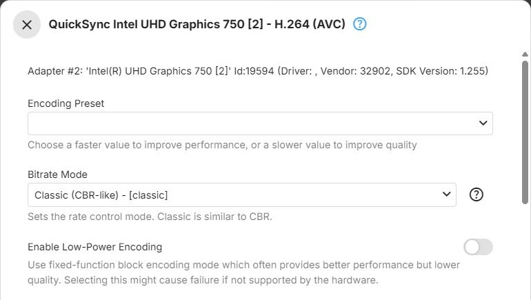

Intel GPUs encode with [Quick Sync Video](xref:Learn-Hardware-Intel-QSV), the media engine built into
Intel graphics. These parameters apply to the Quick Sync encoders of the QSV on D3D11 (Windows) and QSV on
VAAPI (Linux) context types - see [Intel](../../hardware/vendors/Intel.md) for the context types, and
[Encoders](Encoders.md) for how the dialog works. The VAAPI (Intel) context type uses the
[VAAPI](VAAPI.md) encoders, and Vulkan (Intel) the [Vulkan](Vulkan.md) encoders.

## H.264

The `h264_qsv` encoder for [H.264](xref:Learn-Video-Codec-H264), offered by the QSV on D3D11 and QSV on
VAAPI context types.

**Encoding Preset** - trades encoding speed against compression efficiency
([preset](xref:Learn-Video-Encoder-Presets), ffmpeg `preset`). Faster presets encode more frames per second
at lower quality for a given bitrate; slower presets the opposite. Choices, from fastest to slowest:
**Veryfast**, **Faster**, **Fast**, **Medium**, **Slow**, **Slower**, **Veryslow**, after an empty first
entry. Default: empty, which passes no preset, so the encoder's own default applies.

**Bitrate Mode** - how the bitrate Emby requests is passed to the encoder. Default: **Classic
(CBR-like)**.

- **Classic (CBR-like)** - sets the target bitrate, a maximum rate equal to it and a buffer of twice the
  bitrate ([VBV](xref:Learn-Video-Encoding-VBV)): a constrained, CBR-like behaviour
- **Variable Bitrate (VBR)** - sets only the target bitrate and lets the bitrate vary with scene
  complexity ([VBR](xref:Learn-Video-Encoding-VBR)). Generally better quality for the same amount of data
  than Classic, with a less predictable size
- **Constant Bitrate (CBR)** - sets the target bitrate and an equal maximum rate, without the buffer size
  Classic sets ([CBR](xref:Learn-Video-Encoding-CBR)). For strict bandwidth limits

**Enable Low-Power Encoding** - uses the GPU's [fixed-function](xref:Learn-Hardware-Fixed-Function)
encoding mode, Intel's VDEnc (ffmpeg `low_power`). It is often faster, but lower in quality. Transcoding
fails if the hardware does not support this mode for the codec. Default: off.

**Look-Ahead Rate Control** - analyzes upcoming frames before encoding the current one, which allocates
bits more accurately than reacting frame by frame (ffmpeg `look_ahead`). Improves quality at a given
bitrate, at the cost of extra latency and memory. Default: off.

**Look-Ahead Depth** - how many frames ahead to analyze (ffmpeg `look_ahead_depth`). Higher values can
improve bit allocation further, with more latency and memory use. Range 1 to 100; leave it empty (the
default) for the driver's default. Shown only when **Look-Ahead Rate Control** is on.

**Encoding Profile Limit** - the highest H.264 profile the encoder may use; empty (the default) means no
limit - see [Encoding Profile Limit](Encoders.md#encoding-profile-limit). Offers those of
**Baseline Profile**, **Main Profile** and **High Profile** that the GPU reports.

## HEVC

The `hevc_qsv` encoder for [HEVC](xref:Learn-Video-Codec-HEVC), offered by the QSV on D3D11 and QSV on
VAAPI context types.

**Encoding Preset** - trades encoding speed against compression efficiency (ffmpeg `preset`). Faster
presets encode more frames per second at lower quality for a given bitrate; slower presets the opposite.
Choices, from fastest to slowest: **Veryfast**, **Faster**, **Fast**, **Medium**, **Slow**, **Slower**,
**Veryslow**, after an empty first entry. Default: empty, which passes no preset, so the encoder's own
default applies.

**Tier** - the HEVC [tier](xref:Learn-Video-Codec-Levels-Tiers), which sets the maximum bitrate allowed at
the encoding level in use (ffmpeg `tier`). Default: **Main**.

- **Main** - the standard tier, sufficient for the vast majority of content and bitrates
- **High** - allows a higher maximum bitrate at a given level. Only relevant for unusually high bitrates;
  most playback devices support the Main tier only

**Bitrate Mode** - how the bitrate Emby requests is passed to the encoder. Default: **Classic
(CBR-like)**.

- **Classic (CBR-like)** - sets the target bitrate, a maximum rate equal to it and a buffer of twice the
  bitrate: a constrained, CBR-like behaviour
- **Variable Bitrate (VBR)** - sets only the target bitrate and lets the bitrate vary with scene
  complexity. Generally better quality for the same amount of data than Classic, with a less predictable
  size
- **Constant Bitrate (CBR)** - sets the target bitrate and an equal maximum rate, without the buffer size
  Classic sets. For strict bandwidth limits

**Enable Low-Power Encoding** - uses the GPU's fixed-function encoding mode, Intel's VDEnc (ffmpeg
`low_power`). It is often faster, but lower in quality. Transcoding fails if the hardware does not support
this mode for the codec. Default: off.

**Look-Ahead Rate Control** - analyzes upcoming frames before encoding the current one, which allocates
bits more accurately than reacting frame by frame. Improves quality at a given bitrate, at the cost of
extra latency and memory. For HEVC, this turns on Quick Sync's extended bitrate control (ffmpeg `extbrc`),
which performs the look-ahead analysis. Default: off.

**Look-Ahead Depth** - how many frames ahead to analyze (ffmpeg `look_ahead_depth`). Higher values can
improve bit allocation further, with more latency and memory use. Range 1 to 100; leave it empty (the
default) for the driver's default. Shown only when **Look-Ahead Rate Control** is on.

**Encoding Profile Limit** - the highest HEVC profile the encoder may use; empty (the default) means no
limit - see [Encoding Profile Limit](Encoders.md#encoding-profile-limit). Offers those of
**Main Profile**, **Main 10 Profile** and **Main Still Picture** that the GPU reports.

## AV1

The `av1_qsv` encoder for [AV1](xref:Learn-Video-Codec-AV1), offered by the QSV on D3D11 and QSV on VAAPI
context types.
AV1 encoding is used for media conversions only, not for transcoding during playback.

**Encoding Preset** - trades encoding speed against compression efficiency (ffmpeg `preset`). Faster
presets encode more frames per second at lower quality for a given bitrate; slower presets the opposite.
Choices, from fastest to slowest: **Veryfast**, **Faster**, **Fast**, **Medium**, **Slow**, **Slower**,
**Veryslow**. Default: **Medium**.

**Bitrate Mode** - how the bitrate Emby requests is passed to the encoder. Default: **Classic
(CBR-like)**.

- **Classic (CBR-like)** - sets the target bitrate, a maximum rate equal to it and a buffer of twice the
  bitrate: a constrained, CBR-like behaviour
- **Variable Bitrate (VBR)** - sets only the target bitrate and lets the bitrate vary with scene
  complexity. Generally better quality for the same amount of data than Classic, with a less predictable
  size
- **Constant Bitrate (CBR)** - sets the target bitrate and an equal maximum rate, without the buffer size
  Classic sets. For strict bandwidth limits

**Enable Low-Power Encoding** - uses the GPU's fixed-function encoding mode, Intel's VDEnc (ffmpeg
`low_power`). It is often faster, but lower in quality. Transcoding fails if the hardware does not support
this mode for the codec. Default: off.

**Look-Ahead Rate Control** - analyzes upcoming frames before encoding the current one, which allocates
bits more accurately than reacting frame by frame. Improves quality at a given bitrate, at the cost of
extra latency and memory. For AV1, this turns on Quick Sync's extended bitrate control (ffmpeg `extbrc`),
which performs the look-ahead analysis. Default: off.

**Look-Ahead Depth** - how many frames ahead to analyze (ffmpeg `look_ahead_depth`). Higher values can
improve bit allocation further, with more latency and memory use. Range 0 to 100; leave it empty (the
default) for the driver's default. Shown only when **Look-Ahead Rate Control** is on.

AV1 encoders have no **Encoding Profile Limit**.

## Further Reading

<xref:Learn-Index-video-encoding-quality-rate-control>
