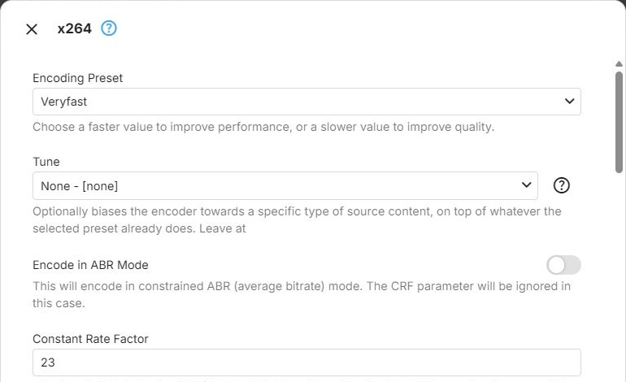
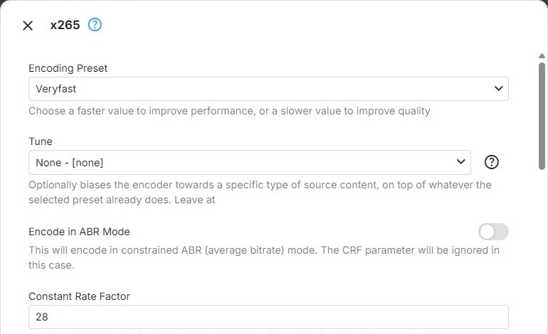

The software encoders run on the CPU. They belong to the Software context type and are used by the
software node of the transcoding configuration. For live transcoding, a software encoder has to keep up
with playback on the server's CPU, which makes the preset the parameter with the largest effect on whether
it can. How the dialog works is described in [Encoders](Encoders.md).

## x264

The `libx264` encoder for [H.264](xref:Learn-Video-Codec-H264), offered by the Software context type.

**Encoding Preset** - trades encoding speed against compression efficiency
([preset](xref:Learn-Video-Encoder-Presets), ffmpeg `preset`). Faster presets need less CPU time per frame
but more bitrate for the same picture quality; slower presets compress better and need more CPU time. For
live transcoding, choose a preset the CPU can sustain in real time for as many simultaneous streams as you
expect. Choices, from fastest to slowest: **Superfast**, **Veryfast**, **Faster**, **Fast**, **Medium**,
**Slow**, **Slower**, **Veryslow**. Default: **Veryfast**.

**Tune** - adjusts the encoder to a particular kind of source content, on top of the preset (ffmpeg
`tune`). Leave it at **None** if unsure. Default: **None**.

- **None** - no content-specific tuning. A safe choice for mixed or unknown content
- **Film** - for live-action video. Slightly reduces deblocking and adjusts psychovisual settings to
  preserve fine detail
- **Animation** - for cartoons and anime with large flat areas and hard edges. Increases deblocking and
  the number of reference frames, and lowers the adaptive quantization strength
- **Grain** - preserves heavy [film grain](xref:Learn-Video-Film-Grain) or noise instead of smoothing it
  away, at the cost of more bitrate spent on fine detail
- **Still Image** - for slideshows and near-static content. Reduces deblocking and strengthens adaptive
  quantization for the sharpest possible still frames
- **Fast Decode** - disables CABAC entropy coding and the in-loop deblocking filter, so the stream is
  cheaper to decode on playback devices with very little processing power. Reduces compression efficiency
- **Zero Latency** - disables B-frames and lookahead, so every frame is output as soon as it is encoded.
  For real-time, low-latency streaming; reduces compression efficiency
- **PSNR (benchmarking only)** - disables psychovisual optimizations to maximize the PSNR quality metric.
  Intended for benchmarking; usually looks worse than an untuned encode of the same size
- **SSIM (benchmarking only)** - the same for the SSIM quality metric

**Encode in ABR Mode** - switches from constant-quality encoding to average-bitrate encoding. When on, the
bitrate Emby requests for the transcode becomes the encoder's target average bitrate (ffmpeg `b`), and
**Constant Rate Factor** is hidden and not used. When off, the encoder aims for the constant quality set by
**Constant Rate Factor**. ABR mode needs a target, so when Emby does not request a bitrate, the encoder
uses the constant rate factor either way. In both modes, the requested bitrate is also set as the maximum
rate, with a buffer of twice the bitrate ([VBV](xref:Learn-Video-Encoding-VBV), ffmpeg `maxrate` and
`bufsize`), which keeps the stream within what the client can receive. Default: off.

**Constant Rate Factor** - the quality level for constant-quality encoding
([CRF](xref:Learn-Video-Encoding-CRF), ffmpeg `crf`). Lower values give better quality and larger output,
higher values smaller output and lower quality; sensible values are between 18 and 28. When the requested
bitrate is too low for the chosen quality, the maximum rate takes precedence. Range 0 to 51, default
**23**. Shown only while **Encode in ABR Mode** is off.

**Adaptive Quantization** - redistributes bits from complex, detailed areas of the picture to flat areas
such as skies, gradients and walls, where blocking and [banding](xref:Learn-Video-Color-Banding) are most
visible (ffmpeg `aq-mode`). Recommended to leave enabled. Default: **Variance (standard)**.

- **Disabled** - every block is treated the same, regardless of its content. Flat areas are more prone to
  visible blocking and banding at a given bitrate
- **Variance (standard)** - the standard algorithm, redistributing bits across the whole video. The
  recommended choice for most content
- **Auto-Variance** - like Variance, but adapts its strength per frame. More experimental; it improves
  some sources, while its general benefit over Variance is debated
- **Auto-Variance (dark-scene bias)** - Auto-Variance with extra bits for dark scenes, where banding in
  shadows and dark gradients is especially noticeable. The most aggressive of the three modes

**Adaptive Quantization Strength** - how strongly adaptive quantization redistributes bits (ffmpeg
`aq-strength`). Higher values protect flat areas more but can soften edges; lower values often suit
grainy or animated content. A decimal number; leave it empty (the default) to use x264's own default of
about 1.0. Shown only when **Adaptive Quantization** is not **Disabled**.

**Encoding Thread Count** - the maximum number of [CPU threads](xref:Learn-Server-CPU-Concurrency) the
encoder uses (ffmpeg `threads`). Use it to limit how much of the CPU a single transcode can take; leave it
empty for maximum performance. Range 0 to 16; 0 or empty (the default) means automatic.

**LibX264 Options** - additional x264 options in x264's own syntax, as `key=value` pairs separated by
colons (ffmpeg `x264-params`). They are applied last, so they override the preset and the fields above
where they set the same option. Default: `subme=0:me_range=4:rc_lookahead=10:partitions=none` - settings
that favour speed over compression efficiency: minimal subpixel motion refinement, a small motion search
range, a lookahead of 10 frames and no partition analysis. Because they override the preset, slower
presets gain less than they otherwise would; clear the field to let the preset decide these settings.

**Encoding Profile Limit** - the highest H.264 profile the encoder may use; empty (the default) means no
limit - see [Encoding Profile Limit](Encoders.md#encoding-profile-limit). Choices: **Baseline Profile**,
**Main Profile**, **High Profile**, **High 10 Profile**, **High 4:2:2 Profile**, **High 4:4:4 Predictive
Profile**.

## x265

The `libx265` encoder for [HEVC](xref:Learn-Video-Codec-HEVC), offered by the Software context type. HEVC
encoding in software takes considerably more CPU time than H.264, so real-time transcoding usually needs
one of the faster presets.

**Encoding Preset** - trades encoding speed against compression efficiency (ffmpeg `preset`). Faster
presets need less CPU time per frame but more bitrate for the same picture quality; slower presets
compress better and need more CPU time. Choices, from fastest to slowest: **Ultrafast**, **Superfast**,
**Veryfast**, **Faster**, **Fast**, **Medium**, **Slow**, **Slower**, **Veryslow**, **Placebo**. Default:
**Veryfast**.

**Tune** - adjusts the encoder to a particular kind of source content, on top of the preset (ffmpeg
`tune`). Leave it at **None** if unsure. Default: **None**.

- **None** - no content-specific tuning. A safe choice for mixed or unknown content
- **Animation** - for cartoons and anime with large flat areas and hard edges
- **Grain** - preserves heavy film grain or noise instead of smoothing it away, at the cost of more
  bitrate spent on fine detail
- **Fast Decode** - turns off the in-loop filters (deblocking and SAO) and some prediction tools, so the
  stream is cheaper to decode on playback devices with very little processing power. Reduces compression
  efficiency
- **Zero Latency** - disables B-frames and lookahead, so every frame is output as soon as it is encoded.
  For real-time, low-latency streaming; reduces compression efficiency
- **PSNR (benchmarking only)** - disables psychovisual optimizations to maximize the PSNR quality metric.
  Intended for benchmarking; usually looks worse than an untuned encode of the same size
- **SSIM (benchmarking only)** - the same for the SSIM quality metric

**Encode in ABR Mode** - switches from constant-quality encoding to average-bitrate encoding. When on, the
bitrate Emby requests for the transcode becomes the encoder's target average bitrate (ffmpeg `b`), and
**Constant Rate Factor** is hidden and not used. When off, the encoder aims for the constant quality set by
**Constant Rate Factor**. ABR mode needs a target, so when Emby does not request a bitrate, the encoder
uses the constant rate factor either way. In both modes, the requested bitrate is also set as the maximum
rate, with a buffer of twice the bitrate (ffmpeg `maxrate` and `bufsize`), which keeps the stream within
what the client can receive. Default: off.

**Constant Rate Factor** - the quality level for constant-quality encoding (ffmpeg `crf`). Lower values
give better quality and larger output, higher values smaller output and lower quality. x265's default of
28 corresponds roughly to x264's 23 in visual quality, which makes it a good starting point. When the
requested bitrate is too low for the chosen quality, the maximum rate takes precedence. Range 0 to 51,
default **28**. Shown only while **Encode in ABR Mode** is off.

**Encoding Thread Count** - the maximum number of CPU threads the encoder uses (ffmpeg `threads`). Use it
to limit how much of the CPU a single transcode can take; leave it empty for maximum performance. Range 0
to 16; 0 or empty (the default) means automatic.

**LibX265 Options** - additional x265 options in the syntax of the x265 command-line tool, as `key=value`
pairs separated by colons (ffmpeg `x265-params`). This is where to set options that have no field of their
own, such as adaptive quantization - for example `aq-mode=3:aq-strength=0.8`. Default: empty.

**Encoding Profile Limit** - the highest HEVC profile the encoder may use; empty (the default) means no
limit - see [Encoding Profile Limit](Encoders.md#encoding-profile-limit). Choices: **Main Profile**,
**Main 10 Profile**.

## SVT-AV1

The `libsvtav1` encoder for [AV1](xref:Learn-Video-Codec-AV1), offered by the Software context type.
AV1 encoding is used for media conversions only, not for transcoding during playback.

**Encoding Preset** - trades encoding speed against compression efficiency, as a number (ffmpeg
`preset`). Lower values are slower and give better quality; higher values are faster. Range 0 (slowest) to
13 (fastest), default **10**.

**Encode in ABR Mode** - switches from constant-quality encoding to average-bitrate encoding. When on, the
bitrate Emby requests for the transcode becomes the encoder's target average bitrate (ffmpeg `b`), and
**Constant Rate Factor** is hidden and not used. When off, the encoder aims for the constant quality set by
**Constant Rate Factor**. ABR mode needs a target, so when Emby does not request a bitrate, the encoder
uses the constant rate factor either way. In both modes, the requested bitrate is also set as the maximum
rate, with a buffer of twice the bitrate (ffmpeg `maxrate` and `bufsize`). Default: off.

**Constant Rate Factor** - the quality level for constant-quality encoding (ffmpeg `crf`). Lower values
give better quality and larger output, higher values smaller output and lower quality. Range 0 to 63,
default **35**. Shown only while **Encode in ABR Mode** is off.

**SVT-AV1 Options** - additional SVT-AV1 options in the syntax of the SVT-AV1 command-line tool, as
`key=value` pairs separated by colons (ffmpeg `svtav1-params`). For example, `tune=0` optimizes for
subjective visual quality instead of PSNR, and `film-grain=8` enables film grain synthesis, which removes
grain before encoding and has the player add it back. Default: empty.

AV1 encoders have no **Encoding Profile Limit**.

## Further Reading

<xref:Learn-Hardware-Encoding>  
<xref:Learn-Index-video-encoding-quality-rate-control>
