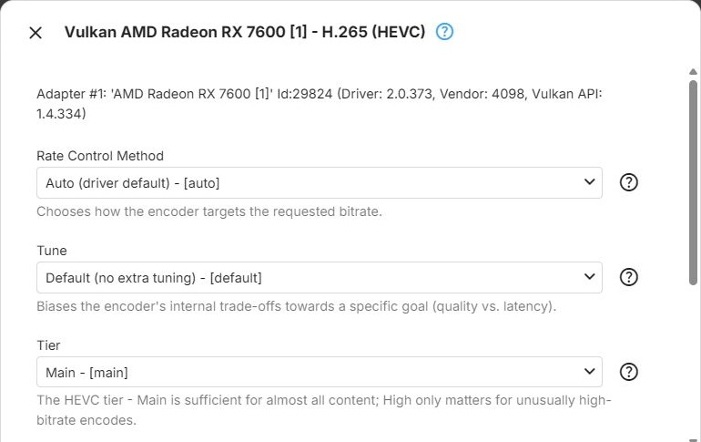

The Vulkan context types - Vulkan (Nvidia), Vulkan (Intel) and Vulkan (AMD) - encode through
[Vulkan Video](xref:Learn-Hardware-Vulkan-Video), the vendor-neutral video extension of
[Vulkan](xref:Learn-Hardware-Vulkan). These context types are experimental - see
[Hardware Acceleration](../../hardware/Overview.md). How the dialog works is described in
[Encoders](Encoders.md).

Only the HEVC encoder has parameters. The H.264 encoder (`h264_vulkan`) and the AV1 encoder (`av1_vulkan`)
have none, and their settings button is disabled.

## HEVC

The `hevc_vulkan` encoder for [HEVC](xref:Learn-Video-Codec-HEVC), offered by the Vulkan (Nvidia), Vulkan
(Intel) and Vulkan (AMD) context types.

**Rate Control Method** - how the encoder reaches the bitrate Emby requests (ffmpeg `rc_mode`). With every
choice, the requested bitrate is passed as the target and maximum rate, with a buffer of twice the
bitrate. Default: **Auto (driver default)**.

- **Auto (driver default)** - lets the driver choose its default behaviour. The recommended starting
  point
- **Driver-Specific** - uses the GPU driver's own built-in rate control instead of one of the standard
  modes below
- **Constant QP** - encodes every frame with the same fixed
  [quantization parameter](xref:Learn-Video-Encoding-QP), using the encoder's default QP value:
  predictable per-frame quality, unpredictable size
- **Constant Bitrate (CBR)** - holds the bitrate as close to constant as possible, regardless of scene
  complexity ([CBR](xref:Learn-Video-Encoding-CBR)). Useful for strict bandwidth limits, at the cost of
  quality consistency across scenes
- **Variable Bitrate (VBR)** - targets an average bitrate and lets it vary with scene complexity
  ([VBR](xref:Learn-Video-Encoding-VBR)). Generally better quality for the same amount of data, with a less
  predictable size

**Tune** - biases the encoder's internal trade-offs towards quality or latency (ffmpeg `tune`). Default:
**Default (no extra tuning)**.

- **Default (no extra tuning)** - no tuning beyond the other settings. A safe baseline if unsure
- **High Quality** - the best quality achievable at the chosen settings and bitrate. Suited to on-demand
  transcoding
- **Low Latency** - reduces encoding latency at some cost in quality and efficiency, for interactive or
  near-real-time streaming
- **Ultra Low Latency** - reduces latency further, with lower quality and efficiency than Low Latency
- **Lossless** - mathematically lossless output instead of a bitrate and quality trade-off. Produces very
  large streams; not suited to streaming

**Tier** - the HEVC [tier](xref:Learn-Video-Codec-Levels-Tiers), which sets the maximum bitrate allowed at
the encoding level in use (ffmpeg `tier`). Main is sufficient for almost all content. Default: **Main**.

- **Main** - the standard tier, sufficient for the vast majority of content and bitrates
- **High** - allows a higher maximum bitrate at a given level. Only relevant for unusually high bitrates;
  most playback devices support the Main tier only

**Encoding Profile Limit** - the highest HEVC profile the encoder may use; empty (the default) means no
limit - see [Encoding Profile Limit](Encoders.md#encoding-profile-limit). Offers those of
**Main Profile** and **Main 10 Profile** that the driver reports.

## Further Reading

<xref:Learn-Hardware-Driver-Capabilities>  
<xref:Learn-Index-video-encoding-quality-rate-control>
