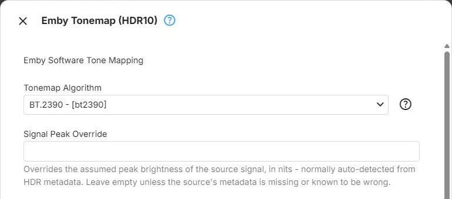
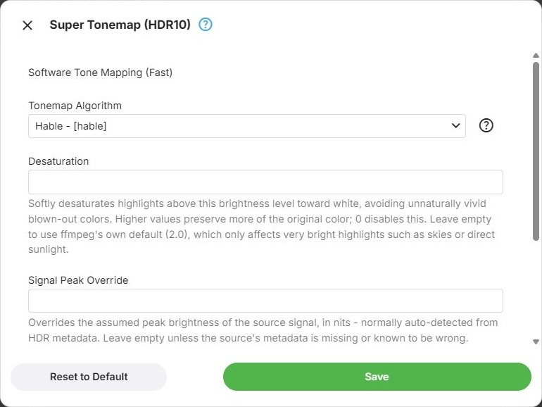
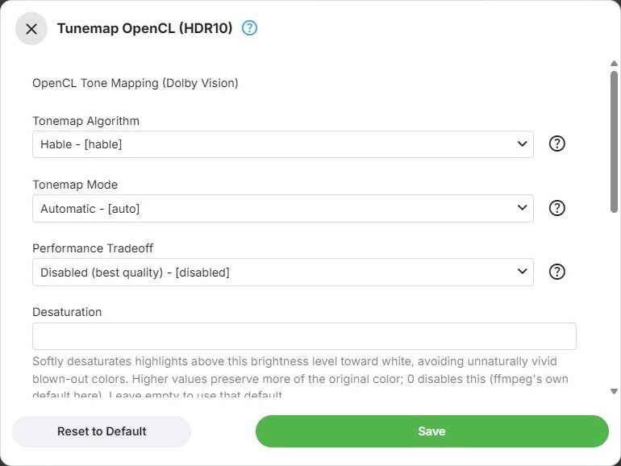
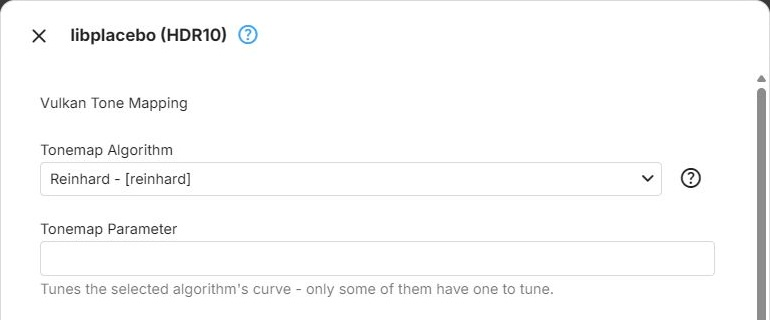

These are the filters offered in the **Tone Mapping** section of a device configuration and in the tone
mapping for image extraction. Filters that share the same parameters are described together. Where filters
are selected, and how the parameters dialog works, is described in [Filters](Filters.md).

Choices are quoted here without the value that the dialog shows after them in square brackets.

## Emby Tonemap

Emby's own tone mapping filter, for all four kinds of HDR. For [HDR10+](xref:Learn-HDR10-Plus) and
[Dolby Vision](xref:Learn-Dolby-Vision) profiles 5 and 8 it uses the per-scene metadata of the video.

- **Emby Tonemap** (`embytonemap`) - Software, on the [CPU](xref:Learn-Tone-Mapping-CPU)
- **Emby Tonemap CUDA** (`embytonemap_cuda`) - [Nvidia CUDA](xref:Learn-Tone-Mapping-CUDA)
- **Emby Tonemap OpenCL** (`embytonemap_opencl`) - QSV on D3D11, QSV on VAAPI, VAAPI (Intel), AMF on D3D11
  and Rockchip, when [OpenCL](xref:Learn-Tone-Mapping-OpenCL) is available on the device
- **Emby Tonemap Vulkan** (`embytonemap_vulkan`) - Vulkan (Nvidia), Vulkan (Intel), Vulkan (AMD) and AMF on
  Vulkan, when [Vulkan](xref:Learn-Tone-Mapping-Vulkan) is available on the device

**Tonemap Algorithm** - the curve that fits the HDR brightness range into SDR. It decides how bright the
picture looks overall and how highlights are compressed - see [Algorithm Choices](#algorithm-choices).
Always shown. The choices are *SMPTE ST 2094-40*, *SMPTE ST 2094-10*, *BT.2390*, *Spline*, *Linear*,
*Gamma*, *Clip*, *Reinhard*, *Hable*, *Mobius* and *ITU-R BT.2446 Method A*; Emby Tonemap Vulkan lists
*Spline* last. The default, and which choices are offered, depend on the kind of HDR:

| Kind of HDR | Default | Not offered |
|---|---|---|
| HDR10 | BT.2390 | SMPTE ST 2094-40, SMPTE ST 2094-10 |
| HDR10+ | SMPTE ST 2094-40 | SMPTE ST 2094-10 |
| DV 5/8 | SMPTE ST 2094-10 | SMPTE ST 2094-40 |
| HLG | BT.2390 | SMPTE ST 2094-40, SMPTE ST 2094-10, ITU-R BT.2446 Method A |

An HDR10 entry chosen in the HDR10+ list behaves as described for HDR10.

**Tonemap Parameter** - fine-tunes the Reinhard and Mobius curves, and is only shown when one of them is
selected. With Reinhard it sets the contrast at peak brightness: higher values make bright areas relatively
brighter. With Mobius it sets the brightness level below which the picture is left unchanged: higher
values keep more of the original image, at the cost of detail in the brightest areas. A decimal number,
empty by default, which uses the filter's built-in value.

**Signal Peak Override** - the peak brightness of the source in [nits](xref:Learn-HDR-Luminance-Nits),
which is normally taken from the video's [HDR metadata](xref:Learn-HDR-Metadata). Only set it when that
metadata is missing or wrong: too high a value darkens the picture, too low a value clips the highlights.
Empty by default, which uses the metadata. Always shown - except for Emby Tonemap CUDA, which does not have
this parameter.

## Super Tonemap

A fast tone mapping filter for [HDR10](xref:Learn-HDR10). It does not use per-scene metadata: chosen in the
HDR10+ list, it tone maps HDR10+ video as HDR10.

- **Super Tonemap** (`supertonemap`) - Software
- **Super Tonemap OpenCL** (`supertonemap_opencl`) - QSV on D3D11, when OpenCL is available on the device

**Tonemap Algorithm** - the curve that fits the HDR brightness range into SDR. It decides how bright the
picture looks overall and how highlights are compressed - see [Algorithm Choices](#algorithm-choices).
Always shown. The choices are *Hable*, *Reinhard*, *Mobius*, *BT.2390* (Super Tonemap only), *Linear*,
*Gamma* and *Clip*. The default is *Hable*.

**Tonemap Parameter** - fine-tunes the Reinhard and Mobius curves, and is only shown when one of them is
selected. With Reinhard it sets the contrast at peak brightness: higher values make bright areas relatively
brighter. With Mobius it sets the brightness level below which the picture is left unchanged: higher
values keep more of the original image, at the cost of detail in the brightest areas. A decimal number,
empty by default, which uses the filter's built-in value.

**Desaturation** - softly fades the colour of highlights above this brightness level towards white, which
avoids unnaturally vivid, blown-out colours. Higher values keep more of the original colour; 0 turns it
off. Always shown. A decimal number, empty by default, which uses ffmpeg's built-in value - 2.0 for Super
Tonemap and 0.5 for Super Tonemap OpenCL. Either only affects very bright highlights such as skies or
direct sunlight.

**Signal Peak Override** - the peak brightness of the source in nits, which is normally taken from the
video's HDR metadata. Only set it when that metadata is missing or wrong: too high a value darkens the
picture, too low a value clips the highlights. Empty by default, which uses the metadata. Always shown.

## Extra Tonemap

An OpenCL tone mapping filter for HDR10. It does not use per-scene metadata: chosen in the HDR10+ list, it
tone maps HDR10+ video as HDR10.

- **Extra Tonemap OpenCL** (`extratonemap_opencl`) - QSV on D3D11, QSV on VAAPI, VAAPI (Intel) and
  Rockchip, when OpenCL is available on the device

**Tonemap Algorithm** - the curve that fits the HDR brightness range into SDR. It decides how bright the
picture looks overall and how highlights are compressed - see [Algorithm Choices](#algorithm-choices).
Always shown. The choices are *Hable*, *Reinhard*, *Mobius*, *Linear*, *Gamma* and *Clip*. The default is
*Hable*.

**Tonemap Parameter** - fine-tunes the Reinhard and Mobius curves, and is only shown when one of them is
selected. With Reinhard it sets the contrast at peak brightness: higher values make bright areas relatively
brighter. With Mobius it sets the brightness level below which the picture is left unchanged: higher
values keep more of the original image, at the cost of detail in the brightest areas. A decimal number,
empty by default, which uses the filter's built-in value.

**Desaturation** - softly fades the colour of highlights above this brightness level towards white, which
avoids unnaturally vivid, blown-out colours. Higher values keep more of the original colour; 0 turns it
off. Always shown. A decimal number, empty by default, which uses ffmpeg's built-in value of 0.5.

**Signal Peak Override** - the peak brightness of the source in nits, which is normally taken from the
video's HDR metadata. Only set it when that metadata is missing or wrong: too high a value darkens the
picture, too low a value clips the highlights. Empty by default, which uses the metadata. Always shown.

## Tunemap

A tone mapping filter for HDR10, Dolby Vision profiles 5 and 8, and [HLG](xref:Learn-HLG), which adapts its
curve to each scene. For Dolby Vision it applies the video's
[Dolby Vision metadata](xref:Learn-Dolby-Vision-RPU). The HDR10 entry is also listed for HDR10+, where it
tone maps HDR10+ video as HDR10.

- **Tunemap CUDA** (`tunemap_cuda`) - Nvidia CUDA
- **Tunemap OpenCL** (`tunemap_opencl`) - QSV on D3D11, QSV on VAAPI, VAAPI (Intel), AMF on D3D11 and
  Rockchip, when OpenCL is available on the device

The defaults are the same for every kind of HDR.

**Tonemap Algorithm** - the curve that fits the HDR brightness range into SDR. It decides how bright the
picture looks overall and how highlights are compressed - see [Algorithm Choices](#algorithm-choices).
Always shown. The choices are *Hable*, *Reinhard*, *Mobius*, *BT.2390*, *Linear*, *Gamma* and *Clip*. The
default is *Hable*.

**Tonemap Mode** - which brightness of a pixel the curve is applied to, which decides how well colours hold
up. Always shown. The default is *Automatic*.

- *Brightest Channel* - the brightest colour channel of each pixel. Simple and fast, but can shift colours
  slightly
- *Per-Channel* - red, green and blue each on their own. Keeps saturation well, but can shift the hue of
  strongly coloured highlights
- *Relative Luminance* - the overall brightness of the pixel, scaling all channels together. Keeps hue and
  saturation better than Per-Channel
- *ICtCp Intensity* - the intensity channel of the ICtCp colour space. Perceptually the most accurate, at a
  slightly higher processing cost
- *Automatic* - ffmpeg chooses, based on the capabilities of the GPU

**Performance Tradeoff** - whether to trade accuracy for speed. Always shown. The default is
*Disabled (best quality)*.

- *Automatic* - ffmpeg decides, based on the GPU
- *Disabled (best quality)* - computes the full curve for every pixel. Highest quality, at the highest
  processing cost
- *Enabled (best performance)* - uses a cheaper approximation, such as a precomputed lookup table. Less load
  on slower GPUs, at a small cost in accuracy

**Tonemap Parameter** - fine-tunes the Reinhard and Mobius curves, and is only shown when one of them is
selected. With Reinhard it sets the contrast at peak brightness: higher values make bright areas relatively
brighter. With Mobius it sets the brightness level below which the picture is left unchanged: higher
values keep more of the original image, at the cost of detail in the brightest areas. A decimal number,
empty by default, which uses the filter's built-in value.

**Desaturation** - softly fades the colour of highlights above this brightness level towards white, which
avoids unnaturally vivid, blown-out colours. Higher values keep more of the original colour; 0 turns it
off. Always shown. A decimal number, empty by default, which uses ffmpeg's built-in value of 0 - no
desaturation.

**Signal Peak Override** - the peak brightness of the source in nits, which is normally taken from the
video's HDR metadata. Only set it when that metadata is missing or wrong: too high a value darkens the
picture, too low a value clips the highlights. Empty by default, which uses the metadata. Always shown.

**Scene Detection Threshold** - how readily the filter detects a scene change while it
[adapts its curve to each scene](xref:Learn-Tone-Mapping-Scene-Adaptive). Lower values make it react to
more scene changes; higher values to fewer, so that after a cut the new scene can keep the previous scene's
brightness for a moment. Always shown. A decimal number, empty by default, which uses ffmpeg's built-in
value of 0.2.

## libplacebo

The tone mapping of the libplacebo video rendering library, for all four kinds of HDR. For HDR10+ and
Dolby Vision profiles 5 and 8 it uses the per-scene metadata of the video.

- **libplacebo** (`libplacebo`) - Vulkan (Nvidia), Vulkan (Intel), Vulkan (AMD) and AMF on Vulkan, when
  Vulkan is available on the device

**Tonemap Algorithm** - the curve that fits the HDR brightness range into SDR. It decides how bright
the picture looks overall and how highlights are compressed - see [Algorithm Choices](#algorithm-choices).
Always shown. The choices are *SMPTE ST 2094-40*, *SMPTE ST 2094-10*, *BT.2390*, *Spline*, *Clip*,
*ITU-R BT.2446 Method A*, *Reinhard*, *Mobius*, *Hable*, *Gamma*, *Linear* and *Automatic*. *Automatic*
lets libplacebo pick the curve that suits the source. The default, and which choices are offered, depend
on the kind of HDR:

| Kind of HDR | Default | Not offered |
|---|---|---|
| HDR10 | BT.2390 | SMPTE ST 2094-40, SMPTE ST 2094-10 |
| HDR10+ | SMPTE ST 2094-40 | SMPTE ST 2094-10 |
| DV 5/8 | SMPTE ST 2094-10 | SMPTE ST 2094-40 |
| HLG | BT.2390 | SMPTE ST 2094-40, SMPTE ST 2094-10, ITU-R BT.2446 Method A |

**Tonemap Parameter** - tunes the shape of the selected curve. What it controls depends on the curve -
for example the contrast of Reinhard, or the brightness below which Mobius leaves the picture unchanged.
Only shown for *Reinhard*, *Mobius*, *Gamma*, *Linear* and *Spline*. A decimal number from 0 to 100, empty
by default, which uses libplacebo's built-in value for the selected curve.

## Algorithm Choices

What the [tone mapping curves](xref:Learn-Tone-Mapping-Curves) do with the picture. Not every filter offers
every curve.

- **SMPTE ST 2094-40** - follows the [per-scene metadata](xref:Learn-Tone-Mapping-Curve-ST2094-40) of
  HDR10+ video. Only offered for HDR10+
- **SMPTE ST 2094-10** - follows the [per-scene metadata](xref:Learn-Tone-Mapping-Curve-ST2094-10) of
  Dolby Vision video. Only offered for DV 5/8
- **BT.2390** - the [ITU-R reference curve](xref:Learn-Tone-Mapping-Curve-BT2390)
  that most HDR-to-SDR converters use. A good, standards-based default. Does not use the parameter
- **Spline** - a [polynomial spline](xref:Learn-Tone-Mapping-Curve-Spline) around a single pivot, which
  adapts to the brightness of the source
- **Linear** - [scales all brightness evenly](xref:Learn-Tone-Mapping-Curve-Linear) to fit. Simple and
  predictable, but can look flat
- **Gamma** - compresses the brightness range with a [power curve](xref:Learn-Tone-Mapping-Curve-Gamma).
  Similar to Linear, but perceptually smoother
- **Clip** - [cuts off](xref:Learn-Tone-Mapping-Curve-Clip) every value above
  the SDR range. Highlights lose their detail and colours can clip harshly
- **Reinhard** - a simple, [classic curve](xref:Learn-Tone-Mapping-Algorithm-Reinhard) that compresses the
  whole brightness range smoothly. The parameter sets the contrast at peak brightness
- **Hable** - a [filmic curve](xref:Learn-Tone-Mapping-Algorithm-Hable)
  that [rolls off highlights](xref:Learn-Tone-Mapping-Highlight-Roll-Off) gradually instead of clipping
  them. A natural, cinematic look, somewhat darker overall. Does not use the parameter
- **Mobius** - leaves colours and contrast within the SDR range [mostly untouched](xref:Learn-Tone-Mapping-Algorithm-Mobius)
  and maps brighter values smoothly into it. The parameter sets the brightness below which nothing changes
- **ITU-R BT.2446 Method A** - an [alternative standards-based curve](xref:Learn-Tone-Mapping-Curve-BT2446A).
  Not offered for HLG

## Filters Without Parameters

These filters run with fixed settings, so the gear button beside them is disabled. Each tone maps HDR10 and
HLG. The HDR10 entry is also listed for HDR10+, where it tone maps HDR10+ video as HDR10.

- **Tonemap QSV** (`vpp_qsv`) - Intel Quick Sync tone mapping, in QSV on D3D11 and QSV on VAAPI
- **Tonemap VAAPI** (`tonemap_vaapi`) - VAAPI tone mapping, in VAAPI (Intel)
- **Tonemap AMF** (`vpp_amf`) - AMD AMF tone mapping, in AMF on D3D11 and AMF on Vulkan

## Further Reading

<xref:Learn-Tone-Mapping-HDR-to-SDR>  
<xref:Learn-Tone-Mapping-Peak-Detection>
