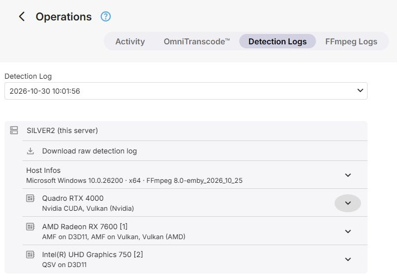
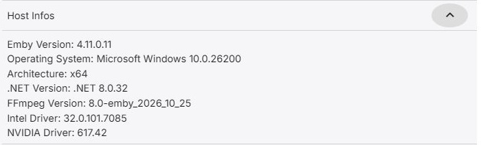
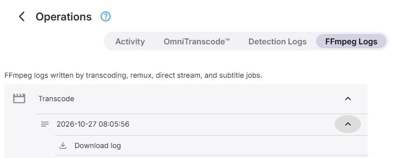

Two tabs of the [Operations](Operations.md) page give access to the logs that matter when hardware
acceleration or a transcode does not behave as expected.

## Detection Logs

Each run of hardware detection keeps its own log, and the tab lists them newest first. Once remote hosts
have written logs, **GPU Host** selects the machine whose logs are listed. The logs of a host that was
removed stay available, listed as *Remote host* with its ID.

An opened log starts with **Host Infos** - the Emby Server version, the operating system and architecture,
the .NET and FFmpeg versions, and the installed Intel, Nvidia and AMD driver versions - followed by a
section for each GPU with what detection found on it. **Download raw detection log** saves the complete
file.

## FFmpeg Logs

FFmpeg writes a log for every transcode, remux, direct stream, subtitle extraction and subtitle conversion.
The tab groups the logs by kind, and within that by job, since a job can write more than one log file. An
opened file shows its first 80 lines; **Download log** saves the whole file.

## Further Reading

<xref:Learn-Playback-Transcode-Logs>  
<xref:Learn-Hardware-Driver-Capabilities>
