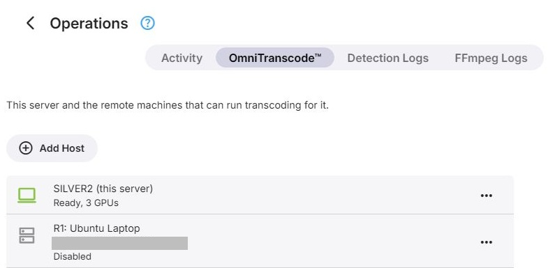
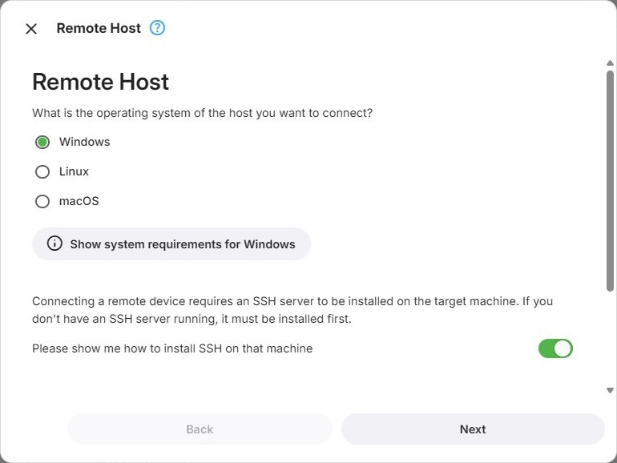
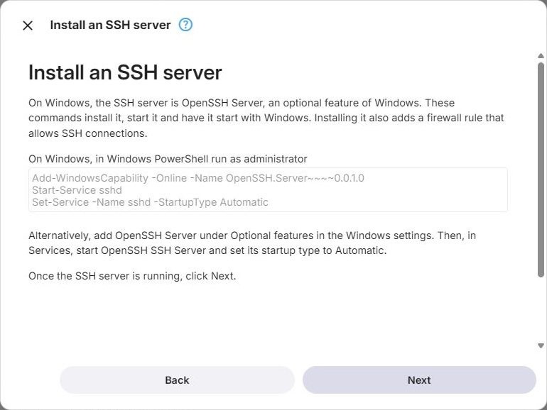
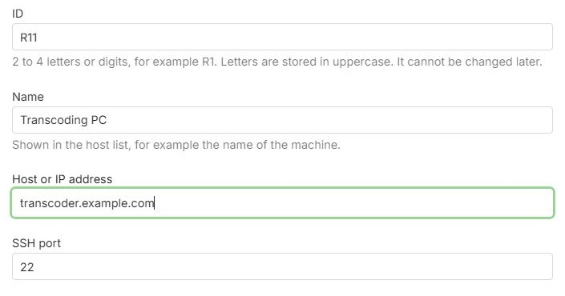

OmniTranscode™ lets Emby Server run transcoding jobs on other computers - remote hosts - and use their
GPUs. Hosts are managed on the **OmniTranscode™** tab of the [Operations](Operations.md) page.

OmniTranscode™ is available when Emby Server runs on Windows or Linux.



*Remote connection details are redacted.*

## How It Works

Emby Server connects to a remote host over SSH and logs in as a user of its own, which is created on the
host for this purpose and used for nothing else. Under that user, Emby installs its own FFmpeg and mounts
the folders FFmpeg needs from the server: the media, the transcoding output, and server data such as fonts
and subtitle caches. The folders are reached through the SSH connection, so no network shares have to be
set up.

GPUs detected on a host become devices in the
[transcoding configuration](../configuration/Transcoding-Configuration.md), just like the server's own:

- In **Basic Mode**, remote GPUs are not used.
- In **Advanced Mode**, newly detected remote GPUs are added switched off. Switch them on to use them.
- In **Expert Mode**, the configuration stays as you built it. Remote GPUs can be placed like any other
  device, including in load-balancing groups.

When the configuration picks a remote GPU for a job, that job's FFmpeg runs on the host. Live TV never uses a
remote GPU.

Any number of hosts can be saved, and up to two can be enabled at a time. A host that is switched off is not
used, and its nodes in the configuration show *Host disabled*.

## Requirements

Only systems that remote transcoding is known to work on are supported; everything else is refused, even
where it might work.

**Windows**

- Windows 10 version 1809 or Windows Server 2019 (build 17763) or newer, including Windows 11 and Windows
  Server 2022/2025
- 64-bit x86 only - no 32-bit, no ARM64
- OpenSSH Server

**macOS**

- macOS 15 or newer on Apple silicon - no Intel Macs
- [macFUSE](https://macfuse.github.io) and its SSHFS

**Linux**

- Ubuntu 24.04, 25.10 and newer; Debian 12 and newer; Fedora 42 and newer; Linux Mint 22.1 and newer; Arch
  Linux, Manjaro and openSUSE Tumbleweed. Derivatives with an identity of their own, such as Pop!_OS,
  EndeavourOS or openSUSE Leap, are not supported.
- 64-bit x86 or 64-bit ARM, running a 64-bit system
- glibc 2.34 or newer, and systemd
- No immutable (ostree) systems such as Fedora Silverblue or Fedora CoreOS

**Not supported, whatever they run:** virtual machines of any kind including cloud instances, containers of
any kind (Docker, Podman, Kubernetes, LXC/Incus, OpenVZ, systemd-nspawn, Windows containers), Proxmox VE, WSL,
and NAS systems.

The requirements are checked when Emby logs in to the host, and again every time the host is prepared.

Beyond that, a remote host needs exactly what Emby Server itself would need on the same system. On Linux,
the Intel and AMD user-space GPU drivers are included, as they are with Emby Server. Windows hosts still
need the manufacturer's graphics drivers installed. See [GPU Setup](../../setup/gpu-setup/GPU-Setup.md)
for the requirements for each platform and GPU.

## Adding a Host

**Add Host** on the OmniTranscode™ tab starts a wizard with the following steps. Editing an existing host
starts at the address step.

### Operating System

Choose whether the host runs Windows, Linux or macOS. **Show system requirements** lists the requirements for
that system. An SSH server must already be running on the host - check **Please show me how to install SSH
on that machine** to get instructions for it.



### Installing an SSH Server

Only shown when the instructions were requested:

- **Windows** - install OpenSSH Server and set its service to start automatically, either in PowerShell or
  through Optional Features and Services
- **Linux** - install and start OpenSSH with the distribution's package manager, and allow it through the
  firewall (ufw or firewalld)
- **macOS** - turn on Remote Login under System Settings → General → Sharing, or with a Terminal command



### Host Address

- **ID** - 2 to 4 letters or digits that identify the host, for example *R1*. It cannot be changed later.
- **Name**
- **Host** - host name or IP address
- **Port** - the SSH port, 22 by default



At this point Emby only checks that an SSH server answers; logging in comes later. When the address is
already used by another host entry, Emby warns about it, and **Next** has to be clicked again to continue
anyway.

### Connection Method

Emby logs in to the host as a user of its own. Choose how that user is set up:

- **Set it up for me** - you provide an administrator login once, and Emby creates the user
- **I want to set it up manually** - Emby shows the commands, and you run them on the host yourself

### Administrator Login

The login is used once, to create Emby's user and authorize Emby's key. It is not saved. On Linux and
macOS, the account must be able to use sudo.

Authenticate either with a user name and password, or with a private key file and its passphrase, if it has
one. A separate **Sudo password** can be given; leave it empty when sudo needs no password.

### Manual Setup

Shows the commands that create Emby's user - to run in a terminal on Linux and macOS, or in Windows
PowerShell run as administrator on Windows. **Next** then logs in as that user.

### Host Setup

Lists what still has to be done on the host with administrator rights, such as installing the software
used to mount the server's folders. With the automatic method, **Perform setup** does it; with the manual
method, the page shows the commands to run. **Next** checks the result, saves the host and starts
preparing it.

If two hosts are already enabled, the new host is saved switched off.

### Preparing the Host

Emby installs its transcoder on the host, mounts the server's folders there and detects the GPUs. The page
shows each step as it runs: connection, login, system, host setup, downloading, installing and testing
FFmpeg, folder mounts, and hardware detection.

The host stays saved even when preparation fails - see [Troubleshooting a Host](#troubleshooting-a-host). A
host that was saved switched off is not prepared.

## Troubleshooting a Host

**Troubleshoot** on an enabled host runs the preparation again, or follows one that is already running, and
lists each step with its result. **Check again** repeats it.

The hardware detection log of each host is available under [Detection Logs](Logs.md#detection-logs), and
the FFmpeg logs of the jobs that ran on it under [FFmpeg Logs](Logs.md#ffmpeg-logs).

### Messages

Where a step cannot be completed, a message says why. Most of them include the error the host or the
connection reported.

- **Same machine** - another host entry already connects to the same address and port. A second entry for
  the same machine gets a user of its own there, and Emby treats the two as separate machines with the same
  GPUs. Click **Next** again to add it anyway.
- **Cannot connect** - no SSH server answered at the address and port. Check that the SSH server is
  running, that address and port are correct, and that no firewall blocks the connection.
- **Login failed** - the host did not accept the [administrator login](#administrator-login).
- **Cannot log in yet** - after [manual setup](#manual-setup), the host does not accept the key of Emby's
  user yet. Check that the commands ran without errors, then click **Next** again.
- **Setup failed** - performing the [host setup](#host-setup) failed.
- **Setup incomplete** - the host setup ran, but something still is not ready. The message lists what.
- **Not done yet** - checking the host showed that not everything listed under
  [host setup](#host-setup) has been done yet. The message lists what remains.
- **Cannot check the host** - Emby could not complete checking the host.
- **Cannot save the host** - the host entry could not be saved.
- **Cannot enable the host** - switching the host on failed.

## Removing a Host

Removing a host cannot be undone; to use the machine again, it has to be added as a new host. Removing only
takes the host out of Emby Server - the user Emby created on the host stays in place.

### Cleaning Up the Host

Emby's user on the host is named *emby* followed by four digits, for example *emby0815*. Everything Emby put
on the host is in that user's home folder, which also contains a file *Why this user exists.txt* that names
the host entry it belongs to and the exact command for removing the user.

- **Linux**

  ```
  sudo userdel -r emby0815
  ```

- **macOS**

  ```
  sudo rm -rfx ~emby0815 && sudo dscl . -delete /Users/emby0815
  ```

- **Windows**, in Windows PowerShell run as administrator

  ```
  $a = Get-LocalUser emby0815; Get-CimInstance Win32_UserProfile -Filter "SID='$($a.SID)'" | Remove-CimInstance; Remove-LocalUser emby0815
  ```

Software that host setup installed for everyone on the machine - WinFsp and SSHFS-Win on Windows, packages
on Linux - stays installed, as does the SSH server. Remove it separately if nothing else uses it.

## Further Reading

<xref:Learn-Hardware-Emby-Server>  
<xref:Learn-Playback-Transcode-Pipeline>
