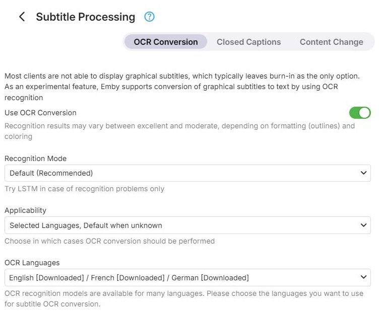
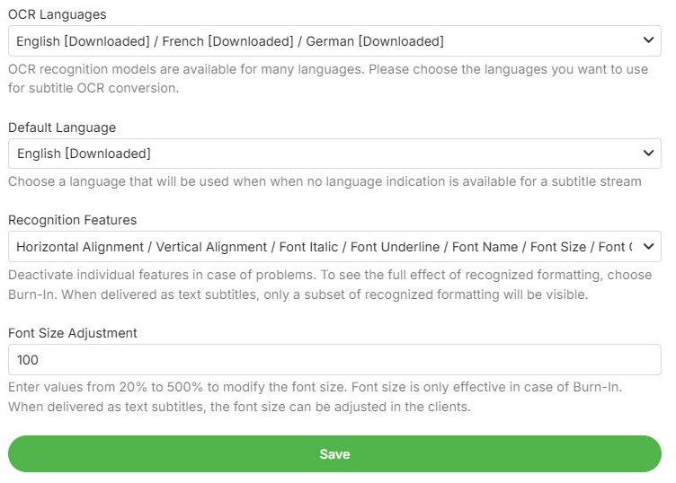

Most clients cannot display graphical subtitles, which usually leaves
[burning them into the video](xref:Learn-Subtitle-Burn-In) as the only option. As an experimental feature,
Emby can convert graphical subtitles to text by optical character recognition (OCR). The settings are on
the **OCR Conversion** tab of the **Subtitle Processing** page in the Transcoding section of the dashboard.

OCR applies to the [bitmap subtitle](xref:Learn-Subtitle-Bitmap) formats
[DVB](xref:Learn-Subtitle-DVB), [DVD](xref:Learn-Subtitle-DVD), [Blu-ray (PGS)](xref:Learn-Subtitle-PGS)
and XSUB. Recognition uses the Tesseract engine. The recognized text also goes through
[Content Change](Content-Change.md), and when the subtitles do not have to be burned in, it can be delivered
to the client as text.

When the server's FFmpeg build lacks what OCR needs, the tab shows *Not available with this server's FFmpeg
build*.

## Settings

- **Use OCR Conversion** - off by default. Recognition results vary between excellent and moderate,
  depending on the formatting of the subtitles (outlines) and their colors.
- **Recognition Mode** - *Default*, which is recommended, or *LSTM*, which is slower. Try LSTM only when
  recognition is poor.
- **Applicability** - in which cases OCR is performed:
  - only when the language of the subtitles is known and among the selected ones (default)
  - for the selected languages, using the default language when the language is unknown
  - always, using the default language when the language is unknown or not among the selected ones
- **OCR Languages** - the languages to recognize. At least one is required when OCR is on. The models of the
  selected languages are downloaded when the settings are saved, and downloaded ones are marked as such.
- **Default Language** - used for subtitles without a language. It must be one of the selected languages.
- **Recognition Features** - which formatting is recognized: horizontal and vertical alignment, bold,
  italic, underline, font name, font size, font color and outline color. All are on by default; turn
  individual ones off in case of problems. The full formatting only shows when the subtitles are burned in;
  delivered as text, only part of it is carried over.
- **Font Size Adjustment** - in percent, 20 to 500, 100 by default. Only effective when the subtitles are
  burned in; delivered as text, the client decides the size.

## Further Reading

<xref:Learn-Subtitle-OCR>  
<xref:Learn-Subtitle-Conversion>
